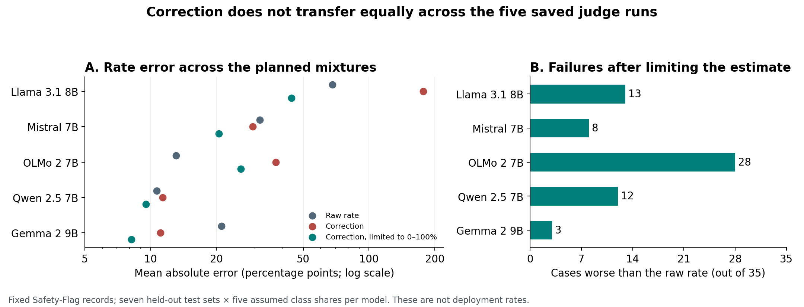

# Does a safety judge's error correction transfer to a different test set?

Date: 2026-10-10 (America/Toronto).  
Study type: secondary data analysis with controlled class reweighting.  
AI use: Codex generated this study and report. No human review or external peer review has occurred.

## Abstract

An AI judge can flag too many or too few items. A standard correction uses its measured error rates to estimate the share of positive reference labels. This correction assumes that the error rates transfer to the target data. We test that assumption with 6,990 saved decisions from five models in Safety-Flag. Each correction uses six test sets. It is then applied to a mixture based on the seventh set. We test five assumed positive-label shares, for 175 cases. The unbounded correction reduces absolute error in 82 cases and increases it in 93. It gives 84 estimates outside 0–100%. Limiting those estimates to 0–100% reduces the overall mean absolute error from 28.89 to 21.66 percentage points. However, 64 cases still become worse than the raw estimate. Results differ greatly by model. This is a test of saved outputs and assumed mixtures. It does not measure harm rates in use.

## Research question

Does a correction based on six test sets reduce rate error on a seventh test set?

An **AI judge** is a model that assigns a label to another item. A **reference label** is the label supplied with the test data. A **positive label** means that the source policy calls for a flag. **Prevalence** is the share of positive labels. A **calibration set** supplies known labels for estimating the judge's errors.

We use *rate* to mean the reference-positive share. The seven source policies do not define harm in the same way.

## Safety relevance

Safety reports can use AI judges to estimate how often a system gives unsafe answers. A correction can remove known judge error only when its assumptions fit the target data. A correction with poor transfer can make an estimate less accurate. A result outside 0–100% also needs an explicit handling rule.

This study gives a repeatable test of that failure mode. It does not evaluate a deployed service or certify a model as safe.

## Related work and contribution

Safety-Flag supplies the saved records and compares error direction, confidence calibration, and selection for human review. Its task-removal check ranks models on the remaining sets. Its temperature-scaling check uses pooled random splits. Those checks differ from estimating a rate on a set excluded from calibration. We use the five primary general-purpose model rows and exclude the mixed-precision 32B reference. [Hu, 2026](https://arxiv.org/html/2609.19072v1)

The correction used here is established. Lee and colleagues analyse corrections for imperfect judges. Their label-shift result requires the conditional judge errors to remain fixed. Fiedler derives bias when calibration errors differ from target errors and studies failures of shared calibration. [Lee et al., ICML 2026](https://proceedings.mlr.press/v306/lee26bl.html); [Fiedler, 2026 preprint](https://arxiv.org/html/2605.06939v1)

Our contribution is a new secondary computation on one fixed release: a full transfer grid, exact mixture errors, bounded and unbounded comparisons, and an item-bootstrap sensitivity audit. We claim no new estimator or first discovery of calibration shift. The search was limited. The dates, terms, read sections, and rejected data options are in [source_search.md](source_search.md).

## Method

### Data and saved plan

We pinned the [Safety-Flag repository](https://github.com/yibo-hu-lab/safety-flag-benchmark/tree/82d39d018c5522dfbdf303b49c5d83a8444d03d2) to commit `82d39d018c5522dfbdf303b49c5d83a8444d03d2`. We used its option-token decision, `solo.answer_lp`. This is the option with the higher probability. It need not equal the generated JSON verdict.

The model rows are Llama-3.1-8B, Mistral-7B, OLMo-2-7B, Qwen2.5-7B, and Gemma-2-9B. The source file aliases identify the saved model runs. We ran no models and downloaded no weights.

We kept the common item IDs across those five models within each set. The result has 1,398 items and 6,990 decisions. The released labels combine several source label systems; they are not fresh human judgments for this study. Only IDs and binary labels are included in the reduced data.

| Test set | Reference negative | Reference positive |
|---|---:|---:|
| BeaverTails | 91 | 109 |
| XSTest | 100 | 100 |
| Ethics | 106 | 94 |
| WildGuard | 100 | 100 |
| Aegis | 100 | 98 |
| ToxiChat | 100 | 100 |
| ToxiGen | 100 | 100 |

The [plan](analysis_plan.md) was saved before rate calculations. The first parser stopped on duplicate Aegis IDs. A separate audit found two identical repeated records per model. Amendment 1 permits identical copies to be counted once and rejects conflicting copies. This change was saved before analysis. The common-ID rule also removes 100 extra BeaverTails items from each of three model files. All five models then use the same 200 items for that set.

### Correction and controlled mixtures

Let $s$ be sensitivity: the fraction of reference-positive items that the judge flags. Let $f$ be the false-positive rate: the fraction of reference-negative items that it flags. Subscripts $c$ and $t$ mean calibration and target.

For each model and target set, we pool confusion counts from the other six sets. **Confusion counts** are the numbers of correct and incorrect decisions for each reference class. Thus each reference class weights those sets by its item count. The target labels do not fit the correction.

We set the target positive share $p$ to 1%, 5%, 10%, 25%, or 50%. We use the target's measured class error rates to calculate the expected judge flag rate:

$$q=p s_t+(1-p)f_t.$$

This changes the class proportions while retaining each target class's saved decision distribution. It is an exact reweighting calculation. It is not a new sample from a deployed model.

The raw estimate is $q$. Define $J_c=s_c-f_c$. The standard corrected estimate is

$$\widehat p=(q-f_c)/J_c.$$

A small $J_c$ amplifies error. We report the estimate without limits and also after **clipping**. Clipping replaces values below zero with zero and values above one with one. The primary comparison uses the unbounded estimate. All 35 source calibrations have positive $J_c$.

The established mismatch identity is

$$\widehat p-p=\frac{p(s_t-s_c)+(1-p)(f_t-f_c)}{J_c}.$$

It follows by substituting $q$ in the correction and subtracting $p$. If both target error rates equal the calibration rates, the numerator is zero. This derivation and the calculation controls apply to the empirical rates. They do not prove that those rates transfer to new content. [Fiedler, Appendix C](https://arxiv.org/html/2605.06939v1)

### Measures, controls, and uncertainty

Absolute error is the distance between an estimate and the assumed share $p$. The error change is corrected absolute error minus raw absolute error. A positive change is worse. We give each of the 175 planned cases equal weight in summary means. This is a grid average, not a deployment average.

The controls use matching source and target error rates, the known $p$, and a fixed 50% estimate. A target-rate correction also recovers $p$ when $s_t-f_t$ is nonzero. Llama's Ethics cell has equal target rates, so that inverse is undefined. The five affected oracle controls are reported, not treated as passes.

We used 2,000 item-bootstrap draws with seed 20261010. A bootstrap draw samples saved items with replacement. We sample within each test-set/reference-class group and use the same item indices for all five models. We recalculate the source and target rates in each draw. A **percentile** is a position in an ordered set of values. The saved 2.5th and 97.5th percentiles describe conditional sensitivity to item resampling.

These ranges are not validated 95% population confidence intervals. Related items can make them too narrow. Fixed class sizes do not represent uncertainty in class prevalence. Empirical rates of zero or one cannot produce unseen outcomes in this bootstrap. If any draw gives $J_c\leq0$, we suppress that cell's correction interval and report the affected fraction.

Calibration excludes the held-out set under the combined test-set and item-ID key. The reduced data cannot rule out related content across different sets. No training or model selection occurs in this study.

## Results

### The correction has different effects across model rows

The unbounded correction improves 82 of 175 cases and worsens 93. It produces 84 estimates outside 0–100%. Mean absolute error rises from 28.89 to 53.23 percentage points. The large Llama errors have a strong effect on that mean.

Clipping changes the result. Its mean absolute error is 21.66 percentage points. It improves 106 cases, worsens 64, and ties in five. Thus the mean improves while a substantial set of cases becomes worse.

| Saved model row | Raw mean error, pp | Corrected mean error, pp | Clipped mean error, pp | Unbounded cases worse / 35 | Clipped cases worse / 35 |
|---|---:|---:|---:|---:|---:|
| Llama-3.1-8B | 68.00 | 176.97 | 44.18 | 26 | 13 |
| Mistral-7B | 31.60 | 29.38 | 20.55 | 17 | 8 |
| OLMo-2-7B | 13.10 | 37.36 | 25.86 | 32 | 28 |
| Qwen2.5-7B | 10.66 | 11.33 | 9.53 | 13 | 12 |
| Gemma-2-9B | 21.10 | 11.09 | 8.17 | 5 | 3 |

Here, **pp** means percentage points. An unbounded estimate can have error above 100 pp. That value is a diagnostic of the inversion, not a valid probability.

The fixed 50% baseline has mean error of 31.80 pp over the five assumed shares. Its error is zero at the 50% share by construction. It does not supply evidence about transfer.

### A worked transfer failure

This example was selected after the full grid was calculated. It explains the mechanism; it is not a separate planned test.

For the OLMo Ethics target, the source sensitivity is 49.26% and the source false-positive rate is 11.00%. The target values are 21.28% and 2.83%. At an assumed positive share of 5%, the expected raw flag rate is 3.75%. The correction returns −18.94%; clipping returns 0%.

The raw error is 1.25 pp. The unbounded corrected error is 23.94 pp. The clipped error is 5.00 pp. The source false-positive rate is too high for this target. Subtracting it gives a negative numerator.

The conditional bootstrap interval for the unbounded error increase is 11.15 to 31.62 pp. This range uses the resampling assumptions above. It does not establish a population-level causal result.

### Instability and checks

Source $J_c$ ranges from 0.0496 to 0.6767. For Llama with BeaverTails held out, 3 of 2,000 bootstrap draws give a nonpositive source $J_c$. Its five mixture intervals are suppressed. The point estimates remain in the tables.

All 175 bias-identity checks and all matching-rate controls pass. The 170 applicable target-oracle checks pass. A separate agent reproduced the point estimates with exact fractions. The saved bootstrap rates permit a separate percentile check. See [review.md](review.md) for the completed review status and [results_grid.csv](results_grid.csv) for every case.

## Discussion

The hypothesis is supported within this grid: correction does not always reduce error. The result is not a reason to use raw rates without checks. The raw errors are also large in several model rows. Gemma improves in 30 of its 35 unbounded cases; OLMo improves in only three.

Clipping makes the output a valid share but does not make the source error rates fit the target. The clipped result still worsens in 64 cases. A useful evaluation must state where its calibration labels came from and test whether the error rates remain suitable for the intended task.

The two class errors matter separately. A positive $J_c$ is not sufficient evidence of transfer. The mismatch formula explains how target sensitivity and false-positive rate differences enter the estimate.

## Limitations

- The grid contains designed mixtures of fixed saved decisions. It does not measure current model behaviour or harm rates in use.
- Each set has a different label policy. Transfer failures can reflect those policy differences as well as content differences. The reduced labels cannot separate these causes.
- The records are a small, selected benchmark sample. Reference labels can be wrong. This study does not audit the source text or establish new human ground truth.
- The five mixture shares are chosen conditions. Changing their weights would change the summary means. The 175 cases share data and are not independent trials.
- The bootstrap treats items within each class and set as exchangeable. It omits hidden clusters, related contrast items, annotation error, and future distribution changes.
- The source model names and saved outputs are fixed. Model updates, prompts, decoding, or native guard interfaces can give different results. We do not regenerate the source outputs.
- We test one standard correction and its clipped form. We do not establish that all corrected estimators fail or select the best alternative.

## Ethical issues and possible misuse

The release contains a reduced table of source IDs, labels, and decisions. It contains no source prompts, personal records, or attack instructions. The derived labels retain Safety-Flag's CC BY 4.0 attribution. The source text is not redistributed.

These results must not be used as a universal ranking of safe models or as a claim about protected groups. The source policies are not a universal definition of harm. The study provides no deployment approval or external endorsement.

## AI use and review status

Codex selected the question, wrote the code, performed the calculations, and generated this report. Separate Codex agents checked prior work, methods, arithmetic, and report support. Agent review is not human review or external peer review. No human has reviewed this report. No new model inference, paid API call, training run, or paid compute was used.

## References

1. Hu, Y. (2026). *Safety-Flag: A Unified Benchmark for the Reliability and Calibration of LLM Content Moderators*. arXiv:2609.19072v1. Preprint. [Paper](https://arxiv.org/html/2609.19072v1). [Pinned data release](https://github.com/yibo-hu-lab/safety-flag-benchmark/tree/82d39d018c5522dfbdf303b49c5d83a8444d03d2).
2. Lee, C., Zeng, T., Jeong, J., Sohn, J.-Y., and Lee, K. (2026). *How to Correctly Report LLM-as-a-Judge Evaluations*. ICML, PMLR 306, 65231–65252. [Proceedings](https://proceedings.mlr.press/v306/lee26bl.html).
3. Fiedler, J. (2026). *Bias and Uncertainty in LLM-as-a-Judge Estimation*. arXiv:2605.06939v1. Preprint. [Paper](https://arxiv.org/html/2605.06939v1).
4. NeurIPS (accessed 2026-10-10). *Paper Checklist Guidelines*. [Checklist](https://neurips.cc/public/guides/PaperChecklist). Used as a review aid; this is not a NeurIPS submission or approval.

## Reproduction

Use the included reduced data and the commands in [README.md](README.md). The main analysis uses Python and NumPy. Matplotlib draws the figure. All point results, 70,000 bootstrap rate rows, source hashes, and logs are included. The analysis takes a few seconds on the recorded local CPU. The optional retrieval script rebuilds the reduced table from the pinned public files.
