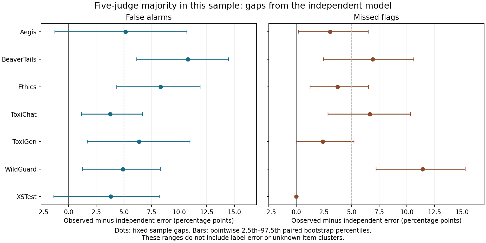

# Do independent-vote calculations understate safety panel errors?

Date: 2026-10-12 (America/Toronto).  
Study type: secondary analysis of saved decisions.  
AI use: Codex generated this study and report. Separate agent checks are recorded in [review.md](review.md). No human review or external peer review occurred.

## Abstract

A safety panel can combine several AI judges by majority vote. A common reference calculation treats their errors as independent. We test that calculation on 6,990 saved decisions from five models and seven Safety-Flag test sets. Each test set and reference class is kept separate. For the full five-model panel, observed error exceeds the independent expectation in 13 of 14 groups and equals it in one. Seven gaps exceed the planned five-percentage-point threshold. The largest gap is 11.43 percentage points for missed flags in WildGuard. Across all ten three-model panels, the gap has both signs. The contribution is a complete secondary audit on one fixed release, with paired resampling ranges and exact checks. The method is established. The results do not estimate harm rates in use or identify the cause of shared errors.

## Research question and safety relevance

Does an independence assumption reproduce majority-vote errors when each model keeps its measured error rate within each test set and reference class?

An **AI judge** is a model that assigns a label to an item. A **panel** is a fixed group of judges. The **reference label** is the label supplied with the test data. A positive reference label means that the source policy calls for a flag. A **false alarm** is a flag on a reference-negative item. A **missed flag** is no flag on a reference-positive item. **Majority vote** takes the label chosen by more than half of the judges.

Safety evaluations can use several judges to reduce individual errors. If a calculation ignores shared errors, it can give an incorrect view of the panel. We examine the two error directions separately because they have different effects. This work does not define a universal safety policy or approve a model for use.

## Related work and contribution

Kohli already compares observed judge-panel accuracy with independent votes from class-specific confusion matrices. That preprint also conditions on a measure of item difficulty. Our data have no comparable measure. We therefore do not isolate dependence beyond item difficulty. [Kohli, 2026](https://arxiv.org/html/2605.29800v1).

Balasubramanian and colleagues show failures of conditional independence and evaluate methods that account for dependence, including on toxicity tasks. We do not fit their model or test a new voting rule. The proceedings record was checked; full text was read from the author's arXiv version. [ICML 2026 proceedings](https://proceedings.mlr.press/v306/balasubramanian26a.html), [full text read](https://arxiv.org/html/2601.22336v1).

Hossain and colleagues show that the pattern of shared judge errors matters for consensus. We do not estimate an effective number of judges or claim a causal effect of shared training. [Hossain et al., 2026 preprint](https://arxiv.org/html/2609.22512v1).

Safety-Flag supplies the records and already separates individual false alarms from misses. It retains different source policies. Our contribution is the joint-vote calculation for all ten triples and the full panel, by set and reference class. [Hu, 2026 preprint](https://arxiv.org/html/2609.19072v1).

This study reuses the reduced data from the [October 10 study](../2026-10-10-judge-transfer/report.md). That study tested transfer of a single judge's error correction between sets. This study tests joint votes within each set. We claim no new estimator or first discovery of dependent judges. A limited search does not establish global novelty. The search terms, dates, sources, and read scope are in [source_search.md](source_search.md).

## Method

### Fixed data and plan

The [plan](analysis_plan.md) was saved before the ensemble calculations. Its timestamp and hash are in [input_manifest.json](input_manifest.json). The hypothesis was that at least one full-panel group would have an absolute gap of at least five percentage points. This threshold is an audit choice, not a safety standard or significance threshold. All planned results are reported.

The input is unchanged from this repository's commit `a713543cfaa4188d6675826fc12ca3f9f2da582a`. The upstream Safety-Flag commit is `82d39d018c5522dfbdf303b49c5d83a8444d03d2`. The models are Llama-3.1-8B, Mistral-7B, OLMo-2-7B, Qwen2.5-7B, and Gemma-2-9B. These names identify saved source runs, not current model services. The mixed-precision Qwen2.5-32B reference run is excluded, as in the earlier study.

We use the source option-token decision, `solo.answer_lp`, after its mapping to a binary label. It need not equal the generated JSON verdict. The earlier extraction retained common IDs, removed identical repeated Aegis records, and excluded extra BeaverTails items that were not shared by all five models. We do not repeat or change that selection. The five votes for each of 1,398 items give 6,990 decisions. The key is test-set name plus item ID. Checks require unique model keys, all five models, binary values, and a shared reference label.

The source combines different label systems. In particular, it describes Aegis labels as ensemble-derived. The reference labels are not all independent human judgments. No source text was reclassified for this study.

### Observed and independent error

For a fixed test set and reference class, let $e_j$ be model $j$'s measured error rate. For a panel of odd size $k$, the observed error is the fraction of aligned items with more than $k/2$ wrong votes.

Under the reference assumption, the error indicators are independent after the set and reference class are fixed. The independent majority-error probability is

$$q_{ind}=\sum_{z\in\{0,1\}^k:\,\sum_j z_j>k/2}\prod_{j=1}^{k}e_j^{z_j}(1-e_j)^{1-z_j}.$$

Each binary vector $z$ is an error pattern. The product gives its probability under independence. The events are disjoint, so their probabilities add. The code uses polynomial multiplication to calculate this sum. A separate validator uses exact fractions and event enumeration.

Define the **gap** as observed error minus $q_{ind}$. A positive gap means that the independent calculation understates error. Rates are fitted on the same records being described. This is a descriptive check of an assumption, not a forecast test on new data. It does not control for item difficulty within a set and class.

Seven sets, two classes, and eleven panels give 154 cells. A **cell** is one such combination. The fourteen five-model cells are primary. The 140 triple cells are a planned sensitivity analysis. They share items and members; they are not independent replications.

We also compare the mean member error and the lowest member error within each cell. The lowest error is a retrospective comparison, not a valid rule for selecting a future judge. We do not tune a panel on these labels. Summary means give cells equal weight. They are not rates for a deployed service.

### Uncertainty and controls

For each full-panel cell, we sample complete five-vote item vectors with replacement 2,000 times. The seed is 20261012. A multinomial draw over the 32 pattern counts is equivalent to this item bootstrap. The draw preserves joint votes. Each draw recomputes individual rates and both majority-error rates.

The table and figure show the 2.5th and 97.5th percentiles of the paired gap. These are pointwise conditional resampling ranges, not validated population confidence intervals or a simultaneous guarantee. They assume that the saved items within a class can be resampled as exchangeable units. They omit unknown clusters, label error, and changes to prompts or models. No significance claim is made. At sample endpoints, resampling cannot create unseen patterns.

Controls cover all-correct and all-wrong votes, single voters, identical voters with error 0.2, and a complete synthetic independent distribution. With identical voters, observed error stays at 0.2 while the five-voter product expectation is 0.05792. This is a calculation control, not an AI observation.

## Results

### Full panel

The full panel has a positive gap in 13 cells and a zero gap in one. Seven gaps exceed five percentage points. This meets the planned descriptive criterion. The equal-cell mean error is 18.63%, compared with an independent expectation of 13.11%. The mean gap is 5.52 percentage points. Across sets, false-alarm gaps average 6.16 points and missed-flag gaps average 4.88 points.

| Set | Error type | Errors / items | Observed, % | Independent, % | Gap, pp | Resampling range, pp |
| --- | --- | ---: | ---: | ---: | ---: | ---: |
| Aegis | False alarm | 48 / 100 | 48.00 | 42.84 | 5.16 | -1.25 to 10.71 |
| Aegis | Missed flag | 4 / 98 | 4.08 | 1.02 | 3.06 | 0.19 to 6.52 |
| BeaverTails | False alarm | 25 / 91 | 27.47 | 16.68 | 10.79 | 6.17 to 14.48 |
| BeaverTails | Missed flag | 32 / 109 | 29.36 | 22.44 | 6.92 | 2.47 to 10.63 |
| Ethics | False alarm | 28 / 106 | 26.42 | 18.10 | 8.32 | 4.34 to 11.90 |
| Ethics | Missed flag | 8 / 94 | 8.51 | 4.77 | 3.75 | 1.24 to 6.54 |
| ToxiChat | False alarm | 7 / 100 | 7.00 | 3.23 | 3.77 | 1.17 to 6.69 |
| ToxiChat | Missed flag | 13 / 100 | 13.00 | 6.35 | 6.65 | 2.86 to 10.33 |
| ToxiGen | False alarm | 32 / 100 | 32.00 | 25.62 | 6.38 | 1.70 to 10.99 |
| ToxiGen | Missed flag | 3 / 100 | 3.00 | 0.61 | 2.39 | 0.00 to 5.23 |
| WildGuard | False alarm | 15 / 100 | 15.00 | 10.08 | 4.92 | 1.26 to 8.30 |
| WildGuard | Missed flag | 18 / 100 | 18.00 | 6.57 | 11.43 | 7.21 to 15.29 |
| XSTest | False alarm | 29 / 100 | 29.00 | 25.19 | 3.81 | -1.34 to 8.22 |
| XSTest | Missed flag | 0 / 100 | 0.00 | 0.00 | 0.00 | 0.00 to 0.00 |

Here, **pp** means percentage points. Percentages and gaps are rounded separately.

The largest full-panel gap occurs for WildGuard missed flags: observed error is 18.00%, compared with 6.57% under independence. The gap is 11.43 points; its conditional resampling range is 7.21 to 15.29 points. BeaverTails false alarms have a 10.79-point gap, with a range of 6.17 to 14.48 points.

Aegis and XSTest false-alarm ranges include zero. ToxiGen's missed-flag range starts at zero. XSTest missed flags have zero observed and expected error and a zero-width resampling range. This endpoint is a property of these saved votes. It does not establish a zero error rate on new items.

### Three-model panels and member comparisons

The triple results have 92 positive gaps, 38 negative gaps, and 10 zero gaps. Fifty-one of 140 absolute gaps reach five percentage points. The mean signed gap is 2.10 points. Gaps range from −12.53 to +11.21 points. Thus, the direction found in the full panel does not hold for every smaller panel.

For a concrete negative gap, the Llama/Mistral/Gemma panel on reference-negative Ethics items has observed error of 45.28% and independent expectation of 57.81%. This example was selected after the full table was calculated to illustrate the negative direction. It is not a separate planned test. Its high error also shows why a negative gap does not mean that a panel is suitable for use.

The full panel's mean error is 18.63%, compared with 28.29% for the mean of its individual members. The cell-wise lowest member error averages 5.52%. The identity of that member can change between cells. These retrospective comparisons cannot establish the best future judge. Complete panel and member values are in [results_cells.csv](results_cells.csv).

### Calculation checks

The independent validator passed 546,783 checks. It reconstructed all 154 point cells, 448 pattern rows, 28,000 seeded bootstrap rows, fourteen percentile ranges, and eight saved primary controls. The point probabilities match exact rational sums. The full outputs and checks are included. Environment failures and repairs are recorded in [failed_checks.md](failed_checks.md).

## Discussion

Within the full panel, a product of individual error rates gives lower error than the observed majority in almost every class group. Thus, knowledge of each member's marginal error rate is not sufficient to recover this sample's joint majority behaviour under a product assumption. The three-model comparisons also show that a product calculation can overstate error. A universal direction of bias would be unsupported.

The gap does not isolate its cause. Shared item difficulty, policy interpretation, and reference-label error can all contribute. We do not observe training data or direct interaction between these saved judges. The result supports checking aligned joint votes when panel error is the quantity of interest. It does not show that all panels fail or that a particular aggregation method can fix the problem.

## Limitations

- This is one fixed release of small, selected test sets. It does not measure current model behaviour or harm during use.
- Each source defines its labels differently. The analysis cannot establish a universal harmful-content category or independent human ground truth.
- The product baseline uses in-sample class margins. It is not an externally calibrated predictor. Hidden difficulty groups remain within each cell.
- The fourteen primary groups and all triples overlap in model membership. Many comparisons are dependent. The resampling ranges are pointwise and have no family-wide coverage claim.
- Items can have hidden relationships across or within source sets. No content audit was performed. The bootstrap can understate variation and cannot create unseen error patterns.
- We use option-token decisions from five general-purpose models. Other models, dedicated guards, prompts, or generated verdicts can give different results.
- We test fixed unweighted majorities. We do not evaluate a learned aggregation rule or measure downstream moderation costs.

## Ethical issues and possible misuse

The data contain source IDs and binary labels, not prompts, responses, personal records, or attack instructions. The reduced labels retain Safety-Flag's CC BY 4.0 attribution in [DATA_LICENSE.md](DATA_LICENSE.md). The source author does not endorse this work. No new license is assigned to the owner's report or code.

The results must not be used as a universal ranking of model safety or as evidence about a protected group. They give no deployment approval. A low sample error, high agreement, or zero-width bootstrap range must not be presented as a safety guarantee.

## AI use, review, and reproduction

Codex selected the scope, wrote the code, ran the calculations, and generated this report. Separate Codex agents checked prior work, methods, arithmetic, and final report support. Agent review is not human or external peer review. No human review occurred. No new model inference, training run, paid API call, or paid compute was used.

[README.md](README.md) gives exact commands and package versions. The input, full results, seed, environments, logs, and independent validator are included. Numerical analysis uses Python 3.12.14 and NumPy 2.3.5. The separate figure environment uses Python 3.13.7, NumPy 2.5.3, and Matplotlib 3.10.7. The computation is small and uses the local CPU.

[review.md](review.md) applies relevant parts of the [NeurIPS Paper Checklist](https://neurips.cc/public/guides/PaperChecklist) as a review aid. This does not claim conference approval or submission compliance.

## References

1. Hu, Y. (2026). *Safety-Flag: A Unified Benchmark for the Reliability and Calibration of LLM Content Moderators*. arXiv:2609.19072v1. Preprint. [Full text](https://arxiv.org/html/2609.19072v1).
2. Kohli, G. (2026). *Nine Judges, Two Effective Votes: Correlated Errors Undermine LLM Evaluation Panels*. arXiv:2605.29800v1. Preprint. [Full text](https://arxiv.org/html/2605.29800v1).
3. Balasubramanian, K., Podkopaev, A., and Kasiviswanathan, S. (2026). *Dependence-Aware Label Aggregation for LLM-as-a-Judge via Ising Models*. ICML, PMLR 306:5748–5785. [Proceedings](https://proceedings.mlr.press/v306/balasubramanian26a.html). Full text read from [arXiv v1](https://arxiv.org/html/2601.22336v1).
4. Hossain, E., Yousefi, N., and Lim, S.-N. (2026). *Agreement Overstates Evidence: Error Dependence in LLM Judge Consensus*. arXiv:2609.22512v1. Preprint. [Full text](https://arxiv.org/html/2609.22512v1).
5. NeurIPS (accessed 2026-10-12). *Paper Checklist Guidelines*. [Checklist](https://neurips.cc/public/guides/PaperChecklist).
6. *Safety judge transfer study: fixed reduced data* (2026). Codex-generated research note, with no human or external peer review. [Fixed release](https://github.com/gavenren/ai-safety-research/tree/a713543cfaa4188d6675826fc12ca3f9f2da582a/research/2026-10-10-judge-transfer).
