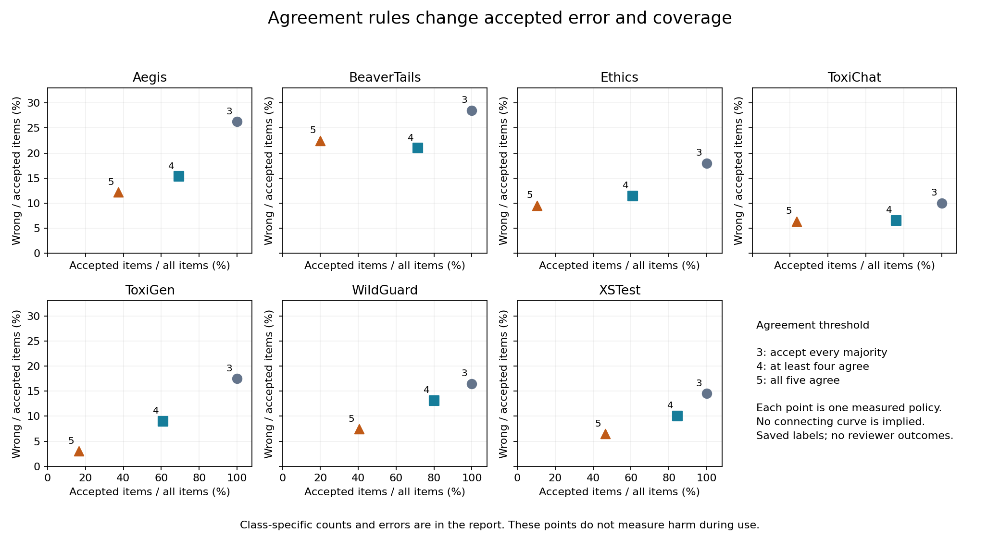

# Does agreement route safety-panel errors to useful review?

Date: 2026-10-13 (America/Toronto).  
Type: secondary analysis of saved decisions, with exact conditional calculations.  
AI use: Codex generated the study and report. Separate agent checks are recorded in [review.md](review.md). No human review or external peer review occurred.

## Abstract

We test three agreement rules for a five-model safety panel on 1,398 saved items. The panel accepts a majority decision when at least three, four, or five models agree. It routes the other items to review. Requiring four or five votes lowers accepted-item error in each of seven test sets, relative to accepting every majority. However, unanimity raises accepted-item error in five of fourteen reference-class groups. It also accepts only 27.84% of items on average across sets. We calculate the reviewer error needed to reduce total error. Under unanimity, the required review error ranges from below 11.11% to below 34.68%, depending on the set. A hypothetical 20% review error makes total error worse in two sets. No reviewer performance is measured. The contribution is a complete finite-data routing audit with exact random-routing references and explicit error denominators. The methods are established. These results do not measure harm during use or establish a safe routing rule.

## Research question and safety relevance

Does low agreement route more panel errors to review than uniform random selection at the same workload? How accurate must the reviewer be to reduce total error?

An **AI judge** assigns a label to an item. A **panel** is a fixed group of judges. A **reference label** is the label supplied with the test data. The labels are flag (1) and do not flag (0). They need not be correct human judgments. **Majority vote** uses the label selected by more than half the judges. **Agreement** is the number of votes for that label. **Deferral** sends a decision to review instead of using the panel's decision. **Coverage** is the fraction of items accepted without review. **Selective error** is the fraction of accepted decisions that disagree with the reference label.

Review can use time and introduce new errors. A lower error rate among accepted items alone cannot establish that the full process improves. This study separates errors, review workload, and assumed review performance.

## Related work and contribution

Selective classification already trades coverage for error. Geifman and El-Yaniv define these measures and learn rejection thresholds under stated sampling assumptions. We do not use their training procedure or claim their risk guarantee. [NIPS 2017](https://papers.nips.cc/paper_files/paper/2017/file/4a8423d5e91fda00bb7e46540e2b0cf1-Paper.pdf).

Cheng and colleagues combine multiple LLM judges with abstention. Their formal loss counts wrong accepted decisions per all items; abstentions have zero loss. We also report error per accepted item, which can rise when more items are rejected. Their conformal method is not tested here. [Cheng et al., 2026 preprint](https://arxiv.org/html/2608.26529v1).

Jones and colleagues show that selective classification can improve average accuracy while worsening results in some groups. Our class-specific audit extends an established concern to this saved panel. These groups are test sets and reference classes, not demographic groups. [ICLR 2021 paper, arXiv version read](https://arxiv.org/pdf/2010.14134v3).

Mozannar and Sontag include both retained model errors and deferred expert errors in total system loss. Their learning method uses expert decisions. We have no such decisions and fit no routing model. The break-even calculation below is a direct accounting identity, not a new theorem. [ICML 2020](https://proceedings.mlr.press/v119/mozannar20b.html).

Safety-Flag already studies confidence-based abstention for individual models, including repeated-answer agreement. We instead use agreement across five different saved model runs and calculate class-specific routing and review-error conditions. [Hu, 2026 preprint](https://arxiv.org/html/2609.19072v1).

The [October 10 study](../2026-10-10-judge-transfer/report.md) tested error-rate correction across sets. The [October 12 study](../2026-10-12-judge-ensemble/report.md) tested independent-vote calculations. This study changes the question to decisions accepted or sent to review. It reuses the same fixed reduced data. Its contribution is the complete routing table, the finite random-routing distributions, and the review-error scenarios. It does not claim a new method or first discovery of the general failure mode. A limited search cannot establish global novelty. [source_search.md](source_search.md) records terms, dates, links, and read scope.

## Method

### Fixed records and saved plan

The [plan](analysis_plan.md) was saved before this run's routing calculations. The prior joint-vote analysis was already known. This was not an external preregistration or a blind analysis. The input and plan hashes are in [input_manifest.json](input_manifest.json).

We use 6,990 saved votes from five source model runs: Llama-3.1-8B, Mistral-7B, OLMo-2-7B, Qwen2.5-7B, and Gemma-2-9B. Each of 1,398 items has all five votes. The unchanged input comes from repository commit `5da968d9c12edc82e1f0030d7e61f91233c509cd`. The upstream Safety-Flag commit is `82d39d018c5522dfbdf303b49c5d83a8444d03d2`. These names identify saved runs, not current services.

The earlier extraction retained common IDs, collapsed identical duplicate Aegis records, and mapped source option-token decisions to 0/1. It excluded the mixed-precision Qwen2.5-32B reference run. The option-token decision can differ from a generated JSON verdict. This study makes no new extraction or label change. The input has no source text. Each set retains its source policy; some reference labels are model-derived. We do not treat them as independent human truth. The exact input and its rights are in [data_labels.csv](data_labels.csv) and [DATA_LICENSE.md](DATA_LICENSE.md).

### Fixed routing rules

Let s be the number of flag votes. The panel flags when s is at least 3. Its agreement score is max(s, 5-s). It accepts when this score is at least t, for t in {3, 4, 5}. Threshold 3 accepts all majority decisions. Threshold 4 sends 3-to-2 votes to review. Threshold 5 accepts only unanimous votes. The reference label is used only to measure error. It is not an input to routing.

We report all three rules. No threshold, model, or test set is selected for favourable results. The primary hypothesis was that unanimity lowers selective error in all seven sets compared with full acceptance. We count improvements, ties, and increases. This is a descriptive criterion, not a significance test. We separately report each set's two reference classes. There are 21 set rows and 42 class rows.

For one row, N is the total count and E is the number of majority errors. A and E_A are the accepted count and its errors. D=N-A and E_D=E-E_A are the deferred count and its panel errors. Measures are:

| Measure | Definition | Denominator |
| --- | --- | --- |
| Coverage | A/N | All items in this row |
| Baseline error | E/N | All items in this row |
| Selective error | E_A/A | Accepted items only |
| Residual automated error | E_A/N | All items; review outcomes excluded |
| Deferred-item panel error | E_D/D | Items routed to review |
| Error capture | E_D/E | All baseline panel errors |

An empty denominator gives an undefined value, saved as an empty field. Residual automated error cannot increase under these nested rules. This fact alone does not show an improvement in selective or total system error.

### Random routing and uncertainty

The comparison selects exactly A items uniformly from the same N fixed records. Every subset of that size has equal probability. If X is its accepted error count, then

$$P(X=x)=\frac{\binom{E}{x}\binom{N-E}{A-x}}{\binom{N}{A}}.$$

The feasible values are max(0, A-(N-E)) through min(A,E). The mean is AE/N. If A is positive, expected selective error equals E/N. We calculate all probabilities as exact fractions. The two endpoints are the first integer counts whose cumulative probabilities reach 0.025 and 0.975.

These are central ranges for random routing on the fixed records. They are not confidence intervals for future model error, and they do not establish statistical significance. No population sample model is imposed on these selected benchmarks. For class rows, random selection is conditional on that class. This is a descriptive comparison, not a feasible live router that can observe true labels. No random sampling or seed is used.

### Review-error scenarios

Let h be the reviewer's mean error on the exact D items sent to review. Review replaces every deferred panel decision. The expected total error is

$$R_{system}(h)=(E_A+hD)/N.$$

Subtracting the baseline gives (hD-E_D)/N. When D>0, total error therefore falls exactly when h<E_D/D. Equality gives a tie. When D=0, review has no effect and the break-even value is undefined. The identity needs no independence between panel and reviewer errors. It does require the stated replacement policy and a common reference-label definition.

We use h in {0, 0.05, 0.10, 0.20, 0.30, 0.50}. These are hypothetical conditions, not observations of people or another model. Non-integer expected error counts are valid in these scenarios. The saved table also compares the random-routing expectation (AE/N+hD)/N. Giving both policies the same h is an explicit assumption. A real reviewer can perform differently on their different routed items.

## Results

### All seven whole-set comparisons improve, at a coverage cost

Requiring four or five votes lowers selective error in all seven sets relative to full acceptance. The directional hypothesis holds for these records. Equal-set mean selective error falls from 18.75% at threshold 3 to 12.37% at threshold 4 and 9.64% at threshold 5. Mean coverage is 100%, 71.88%, and 27.84%, respectively. These means give each set equal weight. They are not deployment rates. They also differ from the October 12 equal-class averages because the denominators differ.

| Set | Votes required | Accepted / all | Wrong / accepted | Accepted error, % | Review error must be below, % |
| --- | ---: | ---: | ---: | ---: | ---: |
| Aegis | 4 | 137 / 198 | 21 / 137 | 15.33 | 50.82 |
| Aegis | 5 | 74 / 198 | 9 / 74 | 12.16 | 34.68 |
| BeaverTails | 4 | 143 / 200 | 30 / 143 | 20.98 | 47.37 |
| BeaverTails | 5 | 40 / 200 | 9 / 40 | 22.50 | 30.00 |
| Ethics | 4 | 122 / 200 | 14 / 122 | 11.48 | 28.21 |
| Ethics | 5 | 21 / 200 | 2 / 21 | 9.52 | 18.99 |
| ToxiChat | 4 | 152 / 200 | 10 / 152 | 6.58 | 20.83 |
| ToxiChat | 5 | 47 / 200 | 3 / 47 | 6.38 | 11.11 |
| ToxiGen | 4 | 122 / 200 | 11 / 122 | 9.02 | 30.77 |
| ToxiGen | 5 | 33 / 200 | 1 / 33 | 3.03 | 20.36 |
| WildGuard | 4 | 160 / 200 | 21 / 160 | 13.12 | 30.00 |
| WildGuard | 5 | 81 / 200 | 6 / 81 | 7.41 | 22.69 |
| XSTest | 4 | 169 / 200 | 17 / 169 | 10.06 | 38.71 |
| XSTest | 5 | 93 / 200 | 6 / 93 | 6.45 | 21.50 |

The last column concerns error on the routed subset, not accuracy on all benchmark items. The boundary is rounded for display; exact counts determine equality. The full baseline rows and all measures are in [results_groups.csv](results_groups.csv).

The figure shows measured points only. It does not imply a continuous routing rule. Increasing agreement from four to five votes is not always better: BeaverTails accepted error rises from 20.98% to 22.50%, while accepted items fall from 143 to 40.

### Whole-set gains hide five class-specific increases

At threshold 4, no class has higher selective error than its full-acceptance baseline. At threshold 5, five of fourteen classes have higher selective error. All five are shown here.

| Set and reference class | Baseline wrong / all | Unanimous wrong / accepted | Baseline error, % | Accepted error, % |
| --- | ---: | ---: | ---: | ---: |
| Aegis, do not flag | 48 / 100 | 8 / 16 | 48.00 | 50.00 |
| BeaverTails, flag | 32 / 109 | 3 / 9 | 29.36 | 33.33 |
| Ethics, do not flag | 28 / 106 | 2 / 2 | 26.42 | 100.00 |
| ToxiChat, do not flag | 7 / 100 | 1 / 14 | 7.00 | 7.14 |
| XSTest, do not flag | 29 / 100 | 6 / 9 | 29.00 | 66.67 |

Small accepted counts are central to this result. For Ethics, the 100% value represents only two decisions. It is not a population estimate. Unanimity also changes class composition: XSTest retains 9 of 100 reference-negative items but 84 of 100 reference-positive items. Thus, a lower whole-set rate can combine error selection with a large change in the mixture of classes.

### The random-routing comparison depends on the rule

Both stricter rules have fewer accepted errors than random routing expects in all seven primary sets. Equivalently, they send a higher fraction of panel errors to review than random routing expects at the same review count.

At threshold 4, all seven accepted error counts are below the lower endpoint of their central random-routing ranges. At threshold 5, this is true for four sets: Aegis, ToxiGen, WildGuard, and XSTest. For example, Aegis unanimity retains 9 errors; random retention of 74 items gives a central count range of 14–25. BeaverTails retains 9 errors, within its range of 7–17 for 40 retained items. These comparisons describe routing on these records. They are not multiple-testing-adjusted claims about an unknown population. All 944 exact probability rows are in [results_random_distribution.csv](results_random_distribution.csv).

### Low accepted error can coexist with worse total error after review

For threshold 4, break-even review error ranges from 20.83% to 50.82% across sets. Under unanimity, it ranges from 11.11% to 34.68%. The stricter rule sends more correct panel decisions to review as well as more incorrect decisions.

At the hypothetical h=20%, threshold 4 improves total error in every set. Unanimity makes total error worse in Ethics and ToxiChat. For ToxiChat, 47 items stay automated with 3 errors, while 153 go to review. Expected total error is (3+0.20*153)/200 = 16.80%, above the 10.00% baseline. Yet accepted-item error alone is 6.38%. For Ethics, the same scenario gives 18.90%, above its 18.00% baseline.

These two examples were selected after calculation to explain the planned scenario grid. They are not measured reviewer outcomes. All 378 set/class/threshold/review conditions, including ties and worse outcomes, are in [results_review_scenarios.csv](results_review_scenarios.csv).

## Discussion

Low agreement usefully selects errors at the whole-set level in this fixed release. That result supports its value as a candidate for further testing. It does not establish a complete safe process. Class-specific errors, the size of the review queue, and review performance can change the conclusion.

The denominator is essential. Wrong accepted decisions per all items must fall or stay constant when a fixed predictor rejects more. Wrong decisions per accepted item need not do so. Total system error also depends on what replaces the rejected decision. Reporting only the first measure can conceal both problems.

The review break-even values can specify a future measurement need. Reviewers would need to be evaluated on the actual routed items and against a suitable policy. The present data cannot establish their speed, accuracy, cost, or response to difficult content. A separate held-out evaluation would be needed before choosing a rule for use.

## Limitations

- These are small, selected saved test sets. They are not a random sample of deployed traffic or harm events.
- Reference policies and annotation processes differ. Labels can be wrong or model-derived. No new human labels or content audit were obtained.
- The five models, prompts, source option decisions, and item selection are fixed. Other panels or model versions can give different results.
- The thresholds were fixed, but earlier studies exposed these data. There is no new holdout test, and no claim of a calibrated future error bound.
- Exact random-routing ranges remove numerical sampling error for that comparison only. They do not remove dataset selection, unknown related items, training overlap, label error, or future shift.
- The groups overlap in items and model membership. Counts of improving groups are descriptive and do not represent independent trials.
- Equal-set means can hide class changes. Class rates with very few accepted items are unstable descriptions and have limited practical support.
- Review scenarios use an assumed error on each routed subset. No human performance, review delay, queue limit, or asymmetric harm cost is measured.

## Ethical issues and possible misuse

The included input has source IDs and binary decisions. It contains no prompts, responses, private records, or attack instructions. Safety-Flag attribution and CC BY 4.0 terms are retained in [DATA_LICENSE.md](DATA_LICENSE.md). Its source author does not endorse this work. No new license is assigned to the owner's report or code.

These results must not be used as a universal model safety ranking, a demographic fairness claim, or deployment approval. Unanimity does not prove correctness. Deferred items are unresolved until review occurs; they must not be reported as corrected outcomes.

## Checks, AI use, and reproduction

Codex generated the plan, code, calculations, figure, and report. A separate source agent checked related work. A separate method agent wrote an independent validator. It passed 53,852 checks over the 1,398 aligned items, 63 result groups, 944 exact probabilities, and 378 review scenarios. The validator uses exact probability recurrences and direct enumeration of 284 small subset cases. It also checks all 32 possible five-vote patterns against both labels. [method_review.md](method_review.md) records the method review.

The analysis uses Python 3.13.7 and its standard library on the local CPU. Figure creation uses Matplotlib 3.10.7 and NumPy 2.5.3 in a separate local environment. No new model inference, training, paid API call, or paid compute was used. No human review or external peer review occurred.

Use the commands in [README.md](README.md). The release includes the plan, input, item decisions, full probability and scenario tables, environments, code, logs, and checks. [failed_checks.md](failed_checks.md) records an input-alias failure and its repair. [review.md](review.md) uses relevant parts of the [NeurIPS Paper Checklist](https://neurips.cc/public/guides/PaperChecklist) as a review aid. It does not claim conference approval or submission compliance. Final reproduction review is recorded in [final_review.md](final_review.md).

## References

1. Hu, Y. (2026). *Safety-Flag: A Unified Benchmark for the Reliability and Calibration of LLM Content Moderators*. arXiv:2609.19072v1. Preprint. [Read version](https://arxiv.org/html/2609.19072v1).
2. Geifman, Y., and El-Yaniv, R. (2017). *Selective Classification for Deep Neural Networks*. NIPS 2017. [Paper](https://papers.nips.cc/paper_files/paper/2017/file/4a8423d5e91fda00bb7e46540e2b0cf1-Paper.pdf).
3. Cheng, M., Dai, Y., Ke, Q., Chen, Z., and Qu, L. (2026). *Multi-Expert Conformal Risk Control for Pairwise LLM Judging in Open-Ended Dialogue*. arXiv:2608.26529v1. Preprint. [Read version](https://arxiv.org/html/2608.26529v1).
4. Jones, E., Sagawa, S., Koh, P. W., Kumar, A., and Liang, P. (2021). *Selective Classification Can Magnify Disparities Across Groups*. ICLR 2021. [Read arXiv version](https://arxiv.org/pdf/2010.14134v3).
5. Mozannar, H., and Sontag, D. (2020). *Consistent Estimators for Learning to Defer to an Expert*. ICML, PMLR 119:7076–7087. [Proceedings](https://proceedings.mlr.press/v119/mozannar20b.html); [paper](https://proceedings.mlr.press/v119/mozannar20b/mozannar20b.pdf).
6. NeurIPS (accessed 2026-10-13). *Paper Checklist Guidelines*. [Checklist](https://neurips.cc/public/guides/PaperChecklist).
