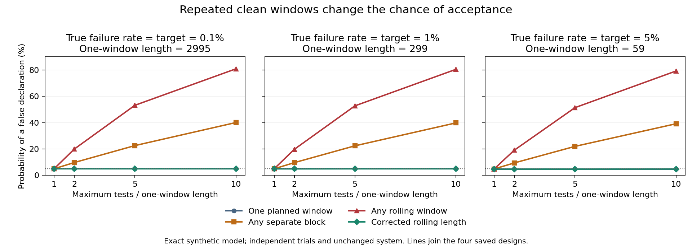

# Can repeated clean windows support a false safety declaration?

Date: 2026-10-14 (America/Toronto).  
Type: exact mathematical audit of a synthetic probability model. No AI model was tested.  
AI use: Codex generated the study and report. Separate agent checks are recorded in [review.md](review.md). No human or external peer review occurred.

## Abstract

A clean test window contains no observed failures. We calculate how repeated use of such windows changes acceptance of an unchanged system. The model assumes independent trials with a constant failure probability and correct labels. At a true failure rate of 1%, one planned window of 299 tests passes with probability 4.95%. Within a budget of 2,990 tests, acceptance of any clean separate block has probability 39.83%. Acceptance of any clean rolling window has probability 80.49%. To limit the rolling rule to 5% at that budget, the minimum window is 616 tests. A window union bound instead requires 1,052 tests. All values are model calculations, not measurements of AI behaviour. The contribution is a reproducible finite-budget comparison and minimum-length table. The repeated-testing problem and the probability methods are established.

## Research question and safety relevance

How does a fixed maximum test count change the probability of a false declaration when any clean window can trigger acceptance? How long must the window be to keep this probability at or below 5%?

A **trial** is one binary test: failure or no failure. A **clean window** is a sequence of tests with no failure. A **rolling window** moves forward by one test at a time. Separate blocks have no shared trials. The **horizon**, H, is the maximum number of trials allowed. The failure probability p is a fixed model input. The declaration claims p<p0, where p0 is a chosen target. It is false when p>=p0, including equality. This strict definition keeps the boundary case clear.

An AI evaluation can reuse a numerical pass criterion after an earlier failure. That changes the decision procedure even if each fresh trial is independent. This study examines a hypothetical procedure. It does not establish how often an organization uses it. A test failure here is not a measured injury, incident, or universal definition of harm.

## Related work and contribution

Littlewood and Wright already explain that repeated zero-failure tests can eventually pass an unchanged faulty system. They study stopping rules that retain earlier failure evidence and consider repairs. We use a fixed system and a fixed horizon. We do not reproduce their Bayesian policy. [Littlewood and Wright, 1997](https://openaccess.city.ac.uk/id/eprint/1614/).

Waiting for consecutive successful trials is an established runs problem. Oh, Park, and Kim provide recurrences for first-run probabilities and related quantities. We give a direct first-hit derivation and an independent coefficient check. We claim no new recurrence or probability theorem. [Oh et al., 2022 preprint, v1](https://arxiv.org/abs/2210.08797v1).

Howard and colleagues distinguish intervals valid at one time from inference valid across time. Our corrected clean-window rule has a fixed horizon. It is not their confidence-sequence method or an unlimited-time guarantee. [Howard et al., 2021; v9 read](https://arxiv.org/pdf/1810.08240v9).

Current AI research also studies valid decisions across time. Yu and colleagues use a betting process for online reasoning selection. Their loss is relative to a thinking model, and their setting includes partial feedback. We do not evaluate their method or use its experiments as evidence for this audit. [Yu et al., 2026 preprint, v1](https://arxiv.org/html/2601.22446v1).

The [October 9 study](../2026-10-09-zero-failure-dependence/report.md) held the test budget and decision time fixed while varying dependence. This study holds trial independence fixed and changes when a declaration can occur. The contribution is the complete 36-condition comparison, twelve integer calibrations, and two first-acceptance distributions. This is a numerical audit using established theory. A limited search does not establish that this exact table is new. [source_search.md](source_search.md) records dates, queries, read sections, and source limits.

## Method

### Saved design and assumptions

The [plan](analysis_plan.md) and [configuration](config.json) were saved before calculation. Their hashes and timestamp are in [input_manifest.json](input_manifest.json). No design change occurred.

Set alpha=0.05. This is a chosen limit on false declarations, not a safety standard. Use p0 in {0.001, 0.01, 0.05}. These correspond to 0.1%, 1%, and 5%. Let q0=1-p0. Choose the smallest positive integer k0 with q0^k0<=alpha. The resulting k0 values are 2,995, 299, and 59.

For each target, use H in {k0, 2k0, 5k0, 10k0}. Evaluate actual p in {p0, 2p0, 5p0}. These 36 conditions are chosen model inputs. They are not fitted from data.

Trials are independent with the same p. The system, input population, failure definition, and labels are fixed. Failures are observed immediately and correctly. A failure does not cause a repair or a new model. All trials, including failures, count towards H. A rolling rule can later accept after an earlier failure. Earlier failures are not removed from the stored history.

### Rules and probability calculations

For any fixed window length k, set q=1-p and B=floor(H/k).

| Rule | Acceptance event | Probability |
| --- | --- | --- |
| One planned window | The first k trials are clean | q^k |
| Separate blocks | At least one of B complete, preassigned blocks is clean | 1-(1-q^k)^B |
| Rolling windows | At least one run of k clean trials occurs by H | 1-F_H |
| Window union bound | Upper bound for rolling acceptance | min(1,(H-k+1)q^k) |

The table assumes H>=k. F_n is the probability that no clean k-run has ended by trial n. For n<k, F_n=1. At n=k, F_k=1-q^k. For n>k,

```
F_n = F_(n-1) - p q^k F_(n-k-1).
```

The subtracted term is the probability of a first clean run ending at n. It requires a prefix with no earlier run, then a failure, then k clean trials. The full proof, endpoint cases, and independent coefficient formula are in [derivations.md](derivations.md).

The one-window event is contained in the separate-block event. That event is contained in the rolling-window event. Their probabilities must follow the same order. Overlapping window events share trials. They are not independent.

### Calibrated lengths and decision criteria

For each (p0,H), k_star is the smallest positive integer with rolling acceptance probability at p0 no greater than alpha. A binary search finds it. The code checks both k_star and k_star-1. The separate validator uses a different formula and a linear search.

The union-bound length k_union is the smallest integer with (H-k+1)q0^k<=alpha. The bound ensures k_star<=k_union. The claim of minimum length applies only within this fixed-length clean-window family.

Acceptance decreases as p increases. A coupling with shared uniform random numbers proves this: increasing p can add failed trials but cannot create a new clean window. Thus p0 is the worst case over p>=p0. Each corrected design controls false declarations under the stated model when the design is fixed in advance. This is not a simultaneous guarantee for selecting among designs after outcomes are seen.

The planned hypothesis is that the uncorrected rolling probability exceeds 5% at p=p0 for every H>k0 in the grid. We report all nine such conditions. The grid also includes twelve cases with p=2p0 and twelve with p=5p0. No acceptance or efficiency analysis for p<p0 was planned.

### Numerical uncertainty

The main code uses Decimal arithmetic with 60 significant digits. CSV probabilities retain 30 decimal places. The independent validator uses a 90-digit coefficient calculation, exact small-case enumeration, and exact run-state checks. No Monte Carlo simulation or random seed is used. There is no sampling confidence interval. Numerical checks cannot establish that a model assumption holds for an AI system.

## Results

### Repetition changes false-declaration probability

The table uses p=p0. Every entry is a model probability. All twelve designs are shown.

| Target p0, % | H | Original k0 | One window, % | Separate blocks, % | Rolling windows, % | Exact corrected k_star | Union-bound k_union |
| ---: | ---: | ---: | ---: | ---: | ---: | ---: | ---: |
| 0.1 | 2,995 | 2,995 | 4.9962 | 4.9962 | 4.9962 | 2,995 | 2,995 |
| 0.1 | 5,990 | 2,995 | 4.9962 | 9.7427 | 19.9597 | 4,067 | 5,972 |
| 0.1 | 14,975 | 2,995 | 4.9962 | 22.6063 | 53.1981 | 5,351 | 11,221 |
| 0.1 | 29,950 | 2,995 | 4.9962 | 40.1022 | 80.8732 | 6,188 | 12,743 |
| 1 | 299 | 299 | 4.9536 | 4.9536 | 4.9536 | 299 | 299 |
| 1 | 598 | 299 | 4.9536 | 9.6619 | 19.7650 | 406 | 582 |
| 1 | 1,495 | 299 | 4.9536 | 22.4329 | 52.7804 | 533 | 929 |
| 1 | 2,990 | 299 | 4.9536 | 39.8334 | 80.4935 | 616 | 1,052 |
| 5 | 59 | 59 | 4.8495 | 4.8495 | 4.8495 | 59 | 59 |
| 5 | 118 | 59 | 4.8495 | 9.4637 | 19.1553 | 80 | 107 |
| 5 | 295 | 59 | 4.8495 | 22.0069 | 51.4076 | 105 | 155 |
| 5 | 590 | 59 | 4.8495 | 39.1707 | 79.2074 | 121 | 176 |

All nine repeated rolling designs exceed 5%. This meets the planned descriptive criterion. One-window probabilities remain unchanged because later tests cannot change that rule's decision. The separate-block rule also exceeds 5% in all nine repeated designs.



The lines join the four planned horizons. The corrected rolling series uses a different prespecified window length at each horizon. It does not represent one policy that changes its horizon after seeing outcomes.

### Minimum length and conservatism of the bound

In the planned 1% example with H=2,990, the minimum corrected length is 616. Its false-declaration probability at p=1% is 4.9943%. Length 615 gives 5.0459%, so it fails the 5% criterion.

The union bound requires length 1,052. The bound at that length is 4.9637%, but the actual rolling probability is only 0.0522%. Shared trials make the bound conservative in this case. We do not estimate an effective number of independent windows.

These lengths are conditional on H=2,990. Reusing length 616 with a larger horizon does not retain the proved 5% bound. For any fixed finite k and 0<=p<1, the chance of eventual acceptance tends to one as the horizon grows. The separate-block formula and event nesting establish this limit.

### A true rate above the target can still pass

At p=2% with the target still 1%, the original 299-test rule passes with probability 0.2380% for one window, 2.3548% for separate blocks, and 12.3901% for rolling windows within H=2,990. The corrected 616-test rolling rule gives 0.0191%.

At p=5%, the original rolling probability in this design is about 0.0030%. Thus the rule is not equally likely to accept all rates above the target. The complete [grid](results_grid.csv) preserves these smaller probabilities as well as the boundary results. The [calibration table](results_calibration.csv) includes every predecessor check.

The planned [time table](results_trajectory.csv) records first acceptance, cumulative acceptance, and no acceptance at each trial from 0 through 2,990. It includes both the 299-test and 616-test rules. The remaining probability at H is no declaration by H; it is not evidence that the system is safe.

### Independent checks

The separate method check matched all 36 grid rows, twelve calibrations, and 5,982 time rows. Its largest saved-probability difference was below 5.0e-31. It also checked 198 exhaustive small cases and 84 exact state cases. These are software and mathematical checks, not measurements of research quality. Details are in [method_review.md](method_review.md) and [validation_results.json](validation_results.json).

## Discussion

A single clean window can be rare while at least one clean window in a long test history is common. Fresh independent trials do not remove this effect. The stopping rule is part of the evidence.

The numerical distinction is large in the selected example: a nominal 5% one-window rule becomes an 80.49% rolling rule at the target boundary. The integer calibration shows one way to restore a finite-horizon error limit within the same rule family. It does not establish a complete safety process.

A valid test plan must specify the system version, failure definition, test distribution, window rule, and maximum test count. All earlier failures must remain visible. If the system is repaired or the test distribution changes, this fixed-p calculation no longer describes the full process. A new analysis is needed.

## Limitations

- All parameters are synthetic. No current AI system, human reviewer, real incident, or deployment traffic was measured.
- Independence, constant p, correct labels, and an unchanged system are strong assumptions. The study does not cover correlated tests, drift, repair, adaptive prompts, or delayed observations.
- A 5% false-declaration limit is not a 95% probability that an accepted system is safe. It does not quantify harm severity or future exposure.
- Each correction applies to one design fixed before test outcomes. The finite grid is not a simultaneous design-selection certificate.
- We did not assess acceptance below the target, expected test cost, or delay for a system that meets the target. Therefore the corrected rule is not shown to be practically efficient or optimal.
- No comparison with a full confidence sequence or other sequential test was run. Those methods have different objectives and assumptions.
- The data are analytic inputs, so benchmark leakage and train-test overlap do not apply. Selection of examples from real AI data was not performed. The 1% time example was fixed in the saved plan.

## Ethical issues, rights, and AI use

The study can help detect overstated test evidence. It must not be used to discard earlier failures, choose a favourable horizon after testing, or approve a deployed system. It contains no harmful prompts, attack instructions, private records, or credentials.

Codex generated the plan, code, derivations, results, figure, and report. Separate agents checked sources, methods, and reproduction. No human or external peer review occurred. No university affiliation, endorsement, certification, or conference approval is claimed.

The work used public papers and local CPU calculation. No new model inference, training, paid API call, or paid compute was used. No third-party paper, dataset, figure, or source code is redistributed. References retain their rights. No new license is assigned to the owner's work.

## Reproduction and references

Run the documented commands in [README.md](README.md). The folder includes inputs, hashes, code, raw probabilities, versions, logs, derivations, and checks. [failed_checks.md](failed_checks.md) records access problems and repairs. [final_review.md](final_review.md) records the separate reproduction review. Relevant parts of the [NeurIPS Paper Checklist](https://neurips.cc/public/guides/PaperChecklist) were used as a review aid only.

1. Littlewood, B., and Wright, D. (1997). *Some Conservative Stopping Rules for the Operational Testing of Safety-Critical Software*. IEEE Transactions on Software Engineering 23(11), 673–683. [Source record and manuscript](https://openaccess.city.ac.uk/id/eprint/1614/). DOI: 10.1109/32.637384.
2. Oh, J., Park, C., and Kim, S. (2022). *Recurrence algorithms of waiting time for the success run of length k in relation to generalized Fibonacci sequences*. arXiv:2210.08797v1. Preprint. [Read version](https://arxiv.org/pdf/2210.08797v1).
3. Howard, S. R., Ramdas, A., McAuliffe, J., and Sekhon, J. (2021). *Time-uniform, nonparametric, nonasymptotic confidence sequences*. The Annals of Statistics 49(2), 1055–1080. DOI: 10.1214/20-AOS1991. [Read v9 revision](https://arxiv.org/pdf/1810.08240v9).
4. Yu, C., Zeng, H., Zhu, Y., Huang, J., Zeng, H., and Jing, B. (2026). *Anytime Safe PAC Efficient Reasoning*. arXiv:2601.22446v1. Preprint. [Read version](https://arxiv.org/html/2601.22446v1).
5. NeurIPS. *Paper Checklist Guidelines*. [Review aid](https://neurips.cc/public/guides/PaperChecklist). Accessed 2026-10-14.
