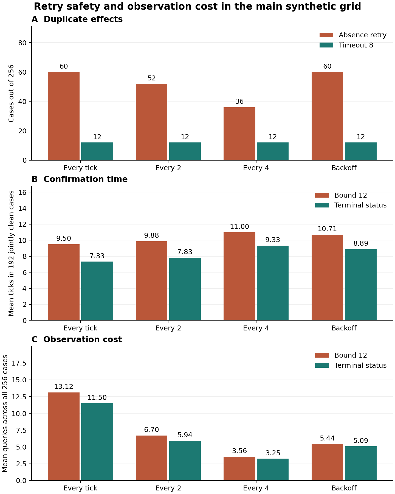

# When a fresh screen is not enough: safe retry timing for computer-use agents

Date: 2026-10-15 (America/Toronto).  
Research type: formal analysis and exhaustive synthetic event study.  
Codex generated this paper, code, and analysis. No human or external peer review occurred. No AI model or browser was tested in the experiment.

## Abstract

Computer-use systems can repeat an action when its result is not visible. A current negative read does not show that an earlier action can no longer take effect. We isolate this problem in a finite model of delayed append actions and delayed reads. We compare five retry rules, four observation schedules, and two server contracts over 336 constructed cases and 13,440 runs. In the main 256-case append grid, a retry after the first empty read produces 60 duplicate results with checks every tick, versus 36 with checks every four ticks. Twelve of 64 zero-lag cases still produce duplicates with checks every tick. A truthful terminal-failure rule and a conservative 12-tick bound both produce zero duplicates and 192 clean confirmations. The terminal rule reduces mean confirmation time on their common successful cases from 9.500 to 7.333 ticks, with fewer queries. Incorrect timing bounds break timeout safety. Terminal status preserves safety but can still miss the deadline. The contribution is a complete, repeatable comparison that separates read freshness, execution closure, and final effects. It applies established systems principles. It does not establish an improvement in real AI model performance.

## 1. Research question and contribution

An agent clicks a button. The next observation shows no new item. Should the agent click again? This question applies to any action that creates an additional record when repeated. A **non-idempotent action** can change the intended result when it is repeated. An **idempotent action** has the same intended effect when repeated [5].

We ask how the completion delay of an earlier action and the delay of an observation affect retry safety, confirmed completion, and observation cost. **Execution closure** means that an earlier attempt can no longer create a future effect. A current read and execution closure are different properties.

The original contribution of this paper is its specific test design and full comparison. We combine pending writes, delayed negative reads, observation schedules, and post-stop effect checks. We include a conservative no-retry control, an adequate fixed-bound baseline, and a matched server-deduplication control. We publish every event trace, including writes that finish after the controller stops. This contribution is a small synthetic benchmark and interface audit. It is not a new exactly-once protocol, learned agent, or general theorem. The limited source search cannot prove that this is the first such comparison.

Reliable completion matters because an extra record can be harmful even when the original task eventually succeeds. Faster tools are useful only if the controller interprets their observations correctly. We therefore keep duplicate prevention, useful completion, delay, and call count separate.

## 2. Related work

CUA-Speedrun studies speed and cost across computer-use configurations. Its fast input-output analysis shows that a screenshot can arrive before an application updates its interface. The tested agent can then take extra steps. Our study isolates retry effects with controlled policies. It does not reproduce that model experiment [1].

RStackBench separates visible success from persisted task state. Its controlled browser tests distinguish delayed persistence from a missing required action. It tests individual fault layers and identifies combined faults as future work. Our model combines a pending non-idempotent write with a negative read and scores all later effects. We do not reuse its code, tasks, or data [2].

CapLease studies repeated agent proposals after uncertain execution. It uses durable authorization state and states the need for a suitable external idempotency contract. We do not propose a replacement for that system. Our comparison concerns the evidence that permits one retry, under explicitly different server contracts [3].

RIFL already treats lost results and duplicate execution as systems problems. Its browser example discusses uncertain outcomes and recognition of prior effects. HTTP Semantics also limits automatic retries of non-idempotent requests. These sources establish that absence of a visible result is not a general retry guarantee [4,5].

The dated search record contains 15 exact queries, read sections, versions, access limits, and additional related work. See [source_search.md](source_search.md) and [references.bib](references.bib). The study does not claim that waiting, verification, durable status, or duplicate suppression is new.

## 3. Method

### 3.1 Saved plan and finite environment

The plan and input configuration were saved before implementation or numerical analysis. A design review then changed the completion guard, still before analysis: an observed count of two stops with a detected duplicate and no completion claim. An observed count of one is the only completion claim. The original hash, amendment time, and final hashes are in [input_manifest.json](input_manifest.json). No cases or hypotheses changed.

Time is an integer **tick**, a synthetic time unit. It is not a measured second. The initial attempt starts at tick zero. Each attempt resolves after its assigned delay, either by committing one durable append or by dropping permanently with no effect. At most one retry is allowed. Both attempts refer to one desired item. A dropped attempt cannot later commit.

At time t, a query returns the exact count and attempt status at historical time max(0, t-L), where L is the case's fixed read lag. Status is pending, committed, or permanently dropped. Due resolutions occur before a query at the same tick. The retry is sent after the query. Each attempt has a positive delay. No controller sees the future delay or outcome before the observation reveals it.

The controller stops on a positive count: one gives a completion claim; two gives a detected duplicate. With no positive result it stops at tick 24. A deadline stop does not cancel an admitted action. Every admitted action continues until resolution, including actions sent at the deadline. The final audit occurs after the last admitted resolution or controller stop, whichever is later.

The model has no other writers, rollback, incorrect status, identity error, read error, or crash. Query calls have no added duration. Delay and call count are therefore separate measures, not a full service-latency model.

### 3.2 Five rules and two server contracts

Each rule makes the same initial submission and follows the same chosen query schedule. A retry is possible only after an empty observation and only if none has been sent before.

| Rule | Condition that permits the one retry |
| --- | --- |
| No retry | Never retry |
| Absence retry | The first empty observation |
| Timeout 8 | An empty observation at tick 8 or later |
| Bound 12 | An empty observation at tick 12 or later |
| Terminal status | The first attempt is observed as permanently dropped |

Timeout 8 uses the main maximum execution delay but ignores read lag. Bound 12 adds the maximum execution delay of 8 to the maximum lag of 4. It is an adequate timing baseline under the main contract. The terminal rule uses information from the same response that the other rules ignore. This extra information is an application capability, not an ability inferred from a screenshot.

Under **append semantics**, each successful attempt creates another item. Under **ideal deduplication**, all successful attempts for the same logical item produce at most one item. A dropped attempt does not prevent a later attempt from succeeding. This matched positive control assumes correct stable identity and server enforcement. The client cannot create this guarantee by assigning a local identifier alone.

### 3.3 Cases, schedules, and measures

The main grid uses both attempt delays in {1,2,4,8}, both outcomes in {commit,drop}, and lag in {0,1,2,4}. This gives 256 cases. The four query schedules are every tick, every 2 ticks, every 4 ticks, and backoff at {1,2,4,8,12,16,20,24}. Five rules and two server modes give 10,240 main runs.

The late-execution stress suite sets both delays to 12 and retains the four main lags: 16 cases. The stale-read suite uses the main delays but lag 8: 64 cases. Both use all rules, schedules, and modes. There are 3,200 stress runs. These suites break one timing bound and remain separate from the main grid.

A **duplicate** is a final effect count greater than one. A **clean confirmation** is a completion claim by tick 24 with exactly one final effect. An **unsafe claim** observes one item, claims completion, and later ends with a duplicate. A detected duplicate and a deadline stop make no completion claim. We also save zero effects and one effect without confirmation.

Mean clean time is the mean confirmation tick among clean cases. Comparisons between terminal status and Bound 12 use their jointly clean cases. The **capped clean-time score** uses the confirmation tick for a clean result and 24 otherwise. This defined score is not wall time. Query and submission counts are reported separately. Full rows and grouped summaries preserve all measures.

All cases are constructed. Equal weighting is a description of this grid, not an estimate of application frequencies. Some delay values repeat when a branch is not taken. These are designed factor combinations, not independent experimental observations. There is no training set, random sampling, fitted parameter, seed, significance test, or population confidence interval.

## 4. Formal boundary

A simple trace shows why freshness is insufficient. At tick 1, a current read sees zero items while the original attempt is pending. A retry commits at tick 2. The controller sees one item and stops. The original attempt then commits at tick 8. The final count is two. Scoring only the controller's stop state would miss the failure.

Consider two worlds with the same observation history before a retry decision. In one, the original attempt will commit later. In the other, it will drop. Suppose the retry succeeds and there is no later distinguishing observation before the decision. If a policy retries with probability r, its duplicate probability in the commit world is r. Its recovery probability in the drop world is also r. Thus a duplicate limit epsilon on this local decision also limits recovery to epsilon. This is a tight, conditional two-world result. It does not apply after new distinguishing evidence arrives and is not a claimed new distributed-systems theorem.

For terminal status, a retry is sent only after a truthful permanent drop. The original attempt therefore cannot add an effect later. At most one remaining attempt exists, so the final count is at most one. Delayed visibility can delay this decision but cannot reverse a permanent drop.

For Bound 12 in the main model, a query at t >= 12 has an as-of time at least 8. The first attempt has resolved by tick 8. If the returned count is zero, that attempt did not commit and cannot do so later. One retry is then safe. This argument fails when the declared execution or lag bound is false. Full assumptions, proofs, and the local ambiguity check are in [derivations.md](derivations.md).

## 5. Results

### 5.1 Current negative reads still permit unsafe retries

The following results use append semantics and queries every tick. Each rule has 256 cases. Time is in ticks. Mean clean time must not be compared across rows with different successful case sets as if those sets were matched.

| Rule | Duplicates | Clean confirmations | Unsafe claims | Mean queries | Mean clean time |
| --- | ---: | ---: | ---: | ---: | ---: |
| No retry | 0 | 128 | 0 | 14.750 | 5.500 |
| Absence retry | 60 | 132 | 56 | 10.109 | 5.848 |
| Timeout 8 | 12 | 180 | 12 | 12.125 | 8.022 |
| Bound 12 | 0 | 192 | 0 | 13.125 | 9.500 |
| Terminal status | 0 | 192 | 0 | 11.500 | 7.333 |

Absence retry creates 60 duplicates (23.44% of this grid). Of these, 56 occur after a one-item completion claim; four are already visible when the controller stops. These are different failure records. Both count as duplicate effects.

In the 64 zero-lag cases, absence retry still produces 12 duplicates (18.75%). This supports H1: current state can be correct while the earlier operation is unfinished. The trace above is one such case. All five policies for that case are in [trace_examples.json](trace_examples.json).

No retry avoids duplicates but confirms only 128 cases. Terminal status and Bound 12 both confirm 192, with zero duplicates. The remaining 64 cases drop both possible attempts. Thus the safe rules recover every case in this main grid where at least one of the two possible attempts can commit. This is a property of the designed cases and deadline, not a real-world success rate.

### 5.2 Terminal status improves the safe timing baseline

Terminal status and Bound 12 have the same 192 clean cases for every schedule. With queries every tick, mean time falls from 9.500 to 7.333 ticks, a reduction of 2.167 ticks or 22.81%. Mean queries across all 256 cases fall from 13.125 to 11.500, a 12.38% reduction. Both use 1.500 submissions per case. Their capped clean-time scores are 13.125 and 11.500 ticks. H2 holds in all four tested schedules.

The improvement comes from earlier evidence that the first attempt permanently dropped. It does not come from hidden knowledge of the outcome. A service without this status signal cannot assume the same benefit.

| Query schedule | Absence duplicates | Timeout 8 duplicates | Bound 12 clean time | Terminal clean time |
| --- | ---: | ---: | ---: | ---: |
| Every tick | 60 | 12 | 9.500 | 7.333 |
| Every 2 ticks | 52 | 12 | 9.875 | 7.833 |
| Every 4 ticks | 36 | 12 | 11.000 | 9.333 |
| Backoff | 60 | 12 | 10.708 | 8.885 |

### 5.3 Faster checks can increase duplicate effects

For absence retry, changing from every four ticks to every tick adds 24 duplicate cases: 36 to 60, or 9.375 percentage points in this grid. Faster reads also change which duplicates are detected before stopping. The paired counts are 24 cases worse with every-tick queries, zero worse with every-four-tick queries, 36 with duplicates in both, and 196 with duplicates in neither. This supports the planned directional comparison H3. It does not mean that slow tools are generally safer or better.

The safe rules show a different cost tradeoff. Terminal status uses 11.500 queries per case with every-tick observation and 3.250 with every-four-tick observation. Its mean clean time rises from 7.333 to 9.333 ticks. Backoff uses 5.094 queries and 8.885 clean ticks. The study does not select an optimal schedule or attach a monetary value to a query.

Figure 1. Main synthetic append grid. Panel A uses all 256 cases. Panels B and C compare terminal status with Bound 12. Their clean case sets match. Panel B uses those 192 cases; Panel C uses all 256. Neither safe rule has a duplicate in this grid. Backoff is the fixed schedule in Section 3.3.

### 5.4 Bound violations and server deduplication

These stress results use every-tick queries. They must not be pooled with the main cases.

| Bound violation | Rule | Cases | Duplicates | Clean confirmations | Deadline stops |
| --- | --- | ---: | ---: | ---: | ---: |
| Delay 12 | No retry | 16 | 0 | 8 | 8 |
| Delay 12 | Bound 12 | 16 | 3 | 6 | 7 |
| Delay 12 | Terminal status | 16 | 0 | 9 | 7 |
| Read lag 8 | No retry | 64 | 0 | 32 | 32 |
| Read lag 8 | Bound 12 | 64 | 4 | 40 | 20 |
| Read lag 8 | Terminal status | 64 | 0 | 41 | 23 |

The 12-tick rule creates three duplicates in the late-execution suite and four in the stale-read suite. The terminal rule creates none. However, it confirms only 9 of 16 and 41 of 64 cases before the deadline. Safety does not imply timely completion. The full schedule results are retained even when they are worse.

Under ideal server deduplication, no policy produces a duplicate in any of the 6,720 matched runs. This confirms the intended positive control. It does not demonstrate an implemented or universal exactly-once service. H4 holds under the stated truthful-status and deduplication contracts.

## 6. Computer-use interface implications

The results support a concrete interface requirement: distinguish an unresolved attempt from a terminal failure with no future effect. A timeout, unchanged screen, or current empty record list is not that failure signal. Where the application supports it, bind status to the specific attempt and keep that identity across recovery.

A controller should retain pending actions after its own wait ends. It should use a documented terminal signal, a valid execution-and-visibility bound, or a server-enforced idempotency contract before a repeat action. If none is available, the outcome remains unresolved. Waiting or asking for review has an availability cost; it does not prove failure.

An evaluator should also let admitted actions finish after the agent stops. In this grid, that step exposes 56 unsafe early claims for every-tick absence retry. A test that checks only the visible count at stop can award success before a duplicate appears. These recommendations apply known systems reasoning to computer-use interfaces. Real browser and model trials remain future work.

## 7. Limitations

The experiment runs a finite event model, not a browser, visual model, or full computer-use agent. Tick values are chosen; call costs and delays are not measured on a service. The grid weights are artificial. Real applications can have unbounded delays, rollback, partial writes, status loss, incorrect status, changing caches, and multiple writers.

The terminal rule assumes a truthful, durable, attempt-specific drop record. Some sites expose no such record. The model gives all rules the same response but only this rule uses that extra field. Its advantage is therefore conditional on an interface capability. A richer failure model can invalidate the guarantee.

Only one retry and one logical item are modeled. There is no crash recovery, concurrent controller, permission change, authentication failure, or imperfect action identity. Ideal deduplication is a control, not a tested implementation. The deadline is fixed, query duration is zero, and the schedules are not learned or optimized. Neither the finite cases nor the proof justify a safety certification or field error estimate.

The same cases are disclosed to the policy designers. The rules are fixed before execution, but this is not a blind benchmark. No held-out real task or model evaluation supports transfer. Further work should test truthful terminal signals and post-stop auditing in controlled browser applications, then in permitted real workflows.

## 8. Ethics, rights, and AI use

The study can help prevent duplicate records and premature completion claims. It contains no harmful prompts, exploit steps, private records, account data, or real transactions. None of the experiment sends messages or changes an external account. GitHub publication is a separate authorized action, not experimental evidence.

Codex generated the plan, implementations, calculations, figure, and paper. Separate Codex agents reviewed sources, design, independent calculations, and final reproduction. AI review is not human or external peer review. No human review, university affiliation, endorsement, or certification is claimed. No model inference experiment, training, paid API call, or paid compute service was used.

All input cases are newly constructed. No source paper, benchmark task, dataset, code, or figure is redistributed. Sources retain their rights. No new license is assigned to this work. The paper uses original prose and cites the related methods.

## 9. Checks and reproduction

The main implementation advances the environment one tick at a time. The independent validator uses direct event-time thresholds and does not import the analyzer. It checked all 13,440 run rows, 167,520 trace events, 676 post-stop resolutions, 6,720 matched server pairs, all grouped result tables, and 48 paired comparisons. All checked integer and label fields match exactly. See [method_review.md](method_review.md) and [validation_results.json](validation_results.json).

Run the documented commands in [README.md](README.md). The package includes the saved plan, cases, complete compressed traces, readable examples, summaries, code, dependency versions, logs, proofs, source record, and agent reviews. Relevant parts of the NeurIPS checklist were used to review claims, assumptions, reproduction, limits, rights, and AI use [6]. This is not a conference submission or approval claim. See [final_review.md](final_review.md) for the final reproduction outcome.

## References

1. Aggarwal, P., Jang, L. K., Welleck, S., Fried, D., Salakhutdinov, R., and Koh, J. Y. (2026). *cua-speedrun: Standardized Benchmarking of the Speed of Computer-Use Agents*. arXiv:2609.40284v1, September 30. Preprint. [Source](https://arxiv.org/html/2609.40284v1).
2. Calanza, E. (2026). *RStackBench: A Five-Layer Fault-Injection Method for Measuring Browser-Agent Execution Reliability in Controlled Applications*. Independent author preprint, August. [Source](https://exzilcalanza.info/wp-content/uploads/2026/08/rstackbench-browser-agent-reliability-preprint.pdf).
3. Xu, J., Fan, L., Wang, Z., Li, X., and Liu, H. (2026). *Beyond Single-Use Tokens: Durable Authorization State for Replay-Resistant LLM Agent Actions*. arXiv:2608.01710v1, August 3. Preprint. [Source](https://arxiv.org/html/2608.01710v1).
4. Lee, C., Park, S. J., Kejriwal, A., Matsushita, S., and Ousterhout, J. (2015). *Implementing Linearizability at Large Scale and Low Latency*. SOSP 2015. DOI: 10.1145/2815400.2815416. [Author-hosted paper](https://web.stanford.edu/~ouster/cgi-bin/papers/rifl.pdf).
5. Fielding, R. T., Nottingham, M., and Reschke, J., editors (2022). *HTTP Semantics*. RFC 9110, Section 9.2.2. Internet Standard. [Source](https://www.rfc-editor.org/rfc/rfc9110.html#section-9.2.2).
6. NeurIPS. *Paper Checklist Guidelines*. Accessed October 15, 2026. [Review aid](https://neurips.cc/public/guides/PaperChecklist).
