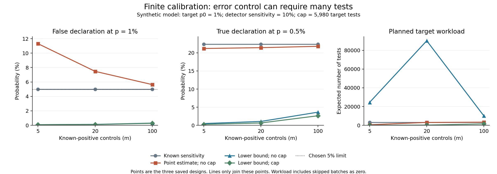

# Can a small detector calibration set invalidate a zero-flag test?

Date: 2026-10-15 (America/Toronto).  
Study type: exact probability audit with synthetic inputs. No AI system was tested.  
AI use: Codex generated the study and report. Separate agent checks are recorded in [review.md](review.md). No human or external peer review occurred.

## Abstract

A zero-flag test can miss real failures when its detector is imperfect. We study a fixed rule that uses known-positive controls to set the size of one fresh target batch. In a planned example with five controls, a true detector sensitivity of 10%, and a failure threshold of 1%, the sensitivity point estimate gives an 11.31% false-declaration probability. This exceeds the intended 5% limit. An exact lower-bound rule reduces it to 0.0849%, but its expected planned target count is 24,489.80. With a cap of 5,980 target tests, that rule starts only 0.856% of batches. It then declares a true rate of 0.5% below the 1% target only 0.2546% of the time. We publish all 1,296 probability and workload conditions. The contribution is a bounded numerical comparison using established binomial methods. No result measures real AI safety or establishes an efficient test.

## Research question and safety relevance

How does a small detector calibration set affect a zero-flag test? Can a lower confidence bound control false declarations, and what happens to acceptance and test workload under a fixed cap?

A **detector** assigns flag or no flag to a target item. A **positive control** is an item known to meet a fixed failure definition. **Sensitivity**, s, is the probability that the detector flags a true failure. **Calibration** uses controls to estimate this probability. A **zero-flag test** makes a declaration only if no target item receives a flag. This is different from observing no true failures.

The true target failure probability is p. The declaration claims p<p0, where p0 is a chosen threshold. It is false for p>=p0, including equality. The chosen false-declaration limit is 5%; it is not a general safety standard. A binary failure label does not define harm severity or an incident rate.

## Related work and contribution

Feng and colleagues use estimated judge error rates in a variance-adjusted test. Their displayed theorem includes a sample-size approximation term. Their limitations identify small calibration sets and rare events as difficult cases and suggest exact binomial limits. We study a narrower zero-flag event. We do not implement or refute their full test. [Feng et al., 2026 preprint, v1](https://arxiv.org/html/2601.20913v1).

Cai and colleagues model independent calibration and target counts. They account for uncertain sensitivity and specificity and allocate error to a set of possible nuisance parameters. A nuisance parameter affects inference but is not the main rate of interest. These principles are established prior work. We use a smaller positive-control model and an explicit probability sum. [Cai et al., 2020 preprint, v1](https://arxiv.org/html/2011.14423v1).

NIST gives exact binomial confidence limits by tail inversion. We use the one-sided lower-limit form and show the required equation and coverage argument. The lower limit is commonly called the Clopper-Pearson limit. [NIST exact binomial equations](https://www.itl.nist.gov/div898/handbook/prc/section2/prc241.htm).

The [October 10 report](../2026-10-10-judge-transfer/report.md) examined transfer across saved test sets. This study assumes transfer and isolates finite calibration uncertainty. The [October 14 report](../2026-10-14-clean-window/report.md) examined repeated windows with correct labels. This study uses one target batch and imperfect detection.

The contribution is the full comparison of four fixed rules, two cap settings, and their test costs and declaration probabilities. It includes a proof for the simple correction and checks of every integer test length. We claim no new estimator, probability theorem, or first warning about judge uncertainty. The limited search cannot establish that this exact table is new. [source_search.md](source_search.md) gives dated queries, read sections, access failures, and rights.

## Method

### Saved design and assumptions

The [plan](analysis_plan.md) and [configuration](config.json) were saved before calculation. [input_manifest.json](input_manifest.json) records their hashes and time. No input or method change occurred. Summary and presentation repairs are in [failed_checks.md](failed_checks.md).

Let K be the number of flags among m known-positive controls. Assume K follows Binomial(m,s): m independent trials with flag probability s. Control labels are correct. Controls must represent the same conditional failure population as the target failures. Easy or selected controls do not establish this condition.

The detector, system, failure definition, and target population remain fixed. A target item is flagged with probability q=p*s+(1-p)*f, where f is the false-positive probability. Target items are independent of each other and of the controls. The grid uses f=0. At a fixed p and s, this maximizes zero-flag probability. The correction proof allows any f>=0.

The calibration result sets the target size through a rule fixed in advance. No target outcome affects that size. There is one calibration set and one fresh target batch. All planned target tests are performed, even if a flag appears early. We assess no repeated attempts, model selection, repair, or early stopping.

### Four rules

Define N(a,b) as the least positive integer n for which (1-p0*a)^n<=b. If a=0, no finite n works.

| Rule | Sensitivity used | Target error allowance | Handling |
| --- | --- | --- | --- |
| Assume perfect detection | 1 | 0.05 | Intentionally wrong baseline when s<1 |
| Know true sensitivity | s | 0.05 | Oracle comparison; true s is unavailable in practice |
| Use point estimate | K/m | 0.05 | K=0 gives no target batch or declaration |
| Use lower bound | L(K) | 0.025 | K=0 gives no target batch or declaration |

For the lower-bound rule, set delta=.025. Let L(0)=0. For k>0, L(k) solves

```
Pr[Binomial(m, L(k)) >= k] = delta.
```

This exact one-sided limit satisfies Pr[L(K)>s]<=delta. The code uses the lower endpoint of a very narrow numerical root bracket. It checks each selected target length and its predecessor.

For each rule use no target cap, and separately use H=20*N(1,.05). The caps for p0=.001,.01,.05 are 59,900, 5,980, and 1,180 tests. If the required n exceeds H, the policy skips the whole target batch and makes no declaration. It never shortens n to H. A skipped batch is not a safety result. The two baselines do not use the controls; K=0 does not prevent them from testing.

### Joint probability, workload, and guarantee

Let A(k)=1 when a target batch launches and zero otherwise. With f=0, the complete declaration probability is

```
R(p,s) = sum over k of Pr(K=k;s) * A(k) * (1-p*s)^n(k).
```

For a baseline that does not use K, the sum reduces to one power or zero. This integrates calibration uncertainty. Substituting K/m for s in a target-only calculation does not give this probability.

On the event L(K)<=s and under p>=p0, q>=p0*L(K). Each launched lower-bound batch then has a declaration probability at most .025. The complementary calibration event has probability at most .025. Thus the unconditional false-declaration probability is at most

```
.025 + (1-.025)*.025 = .049375.
```

This bound holds over repeated control and target samples under the stated model. It is not a 4.9375% bound for each observed K. Removing over-cap batches preserves it. [derivations.md](derivations.md) gives the complete tail, integer-length, cap, and probability arguments.

Planned target workload is E[A(K)*n(K)]. The conditional workload divides this by Pr(A=1), when that probability is positive. The calibrated rules also require m controls; this count stays separate. The oracle and assumed-perfect comparisons use no control data. No money, human time, or actual AI compute is measured.

### Grid and uncertainty

Use p0 in {.001,.01,.05}, m in {5,20,100}, s in {.1,.25,.5,.75,.9,1}, and p/p0 in {.5,1,2}. Four rules and two cap settings give 1,296 rows. The 54 conditions with p=p0 for each rule and cap are the boundary cases. For f=0, declaration probability decreases with p. Thus this boundary is the worst case over p>=p0 at fixed s and policy.

The planned hypothesis is that the point-estimate rule exceeds 5% in at least one uncapped boundary case. We report the full count and maximum. Cases with p=.5*p0 show true declarations; cases with p=2*p0 show false declarations above the boundary. These are chosen model inputs, not estimates from observations.

The main code uses 70-digit Decimal arithmetic and 220 root bisections. Saved probabilities use 30 decimal places. The independent validator uses 90 digits, a different binomial recurrence, 290 bisections, and integer binary search. This is a deterministic finite sum, not a random simulation. No seed or sampling confidence interval is appropriate. Numerical error checks cannot validate the model assumptions.

## Results

### A sensitivity point estimate does not retain the intended error limit

The point-estimate rule exceeds 5% in 41 of 54 boundary conditions, with either cap setting. Its largest probability is 11.3093%, in the planned p0=.01, m=5, s=.1 example. This is the maximum over the chosen grid, not a global maximum. The descriptive hypothesis holds within this grid.

| Rule | Target cap | Cases above 5% | Largest false-declaration probability, % |
| --- | --- | ---: | ---: |
| Assume perfect detection | None | 45 / 54 | 74.3981 |
| Assume perfect detection | 20 times perfect-detector length | 45 / 54 | 74.3981 |
| Know true sensitivity | None | 0 / 54 | 4.9999 |
| Know true sensitivity | 20 times perfect-detector length | 0 / 54 | 4.9999 |
| Use point estimate | None | 41 / 54 | 11.3093 |
| Use point estimate | 20 times perfect-detector length | 41 / 54 | 11.3093 |
| Use lower bound | None | 0 / 54 | 2.1755 |
| Use lower bound | 20 times perfect-detector length | 0 / 54 | 2.1755 |

There are no exact ties with 5% in these boundary rows. The summary records all maximum ties at the saved precision. The baseline rows repeat across m because they ignore calibration. The two cap settings share data and rules. Their counts are descriptive, not independent statistical tests.

The lower-bound rule stays below its proved 4.9375% limit. Its grid maximum is 2.1755%, at p0=.001, m=100, s=1. This shows conservatism within the grid. It does not prove that 2.1755% is a universal bound.

### The planned example exposes both error and workload

Here p0=1%, m=5, and true sensitivity is 10%. For false declarations use p=1%; for true declarations use p=0.5%. The cap is 5,980 target tests. In this example the cap does not alter the first three rules.

| Rule | False declaration at p=1%, % | True declaration at p=0.5%, % | Target batch launched, % | Expected planned target tests |
| --- | ---: | ---: | ---: | ---: |
| Assume perfect; either cap | 74.1448 | 86.1106 | 100.0000 | 299.00 |
| Know sensitivity; either cap | 4.9962 | 22.3605 | 100.0000 | 2,995.00 |
| Point estimate; either cap | 11.3093 | 21.2008 | 40.9510 | 549.82 |
| Lower bound; no cap | 0.0849 | 0.4754 | 40.9510 | 24,489.80 |
| Lower bound; cap 5,980 | 0.0782 | 0.2546 | 0.8560 | 20.96 |

The point estimate needs only 549.82 target tests on average, but it fails the error limit. This mean includes the 59.049% of control samples with K=0, which launch no target batch. It is not the number of tests after a batch starts.

The uncapped lower-bound rule requires 24,489.80 target tests on average. Conditional on launch, its mean is 59,802.70 tests. With the cap, its unconditional mean falls to 20.96 tests, but it launches only 0.856% of batches. Conditional on a capped launch, the mean is 2,448.09 tests. The small unconditional mean mainly reflects skipped tests.

Even when p=0.5%, the uncapped lower-bound rule makes a true declaration only 0.4754% of the time. The cap reduces this to 0.2546%. Low false-declaration probability therefore does not establish a useful or efficient test. The chosen 2.5%/2.5% allocation was not optimized.

### A small control count can change the required batch sharply

These are all six possible calibration outcomes for the same planned example. The lower-bound column is a confidence limit, not the true sensitivity.

| Flags among five controls | Sensitivity lower limit, % | Point-estimate target length | Lower-bound target length | Lower-bound batch fits cap 5,980 |
| ---: | ---: | ---: | ---: | --- |
| 0 | 0.0000 | No finite length | No finite length | No |
| 1 | 0.5051 | 1497 | 73035 | No |
| 2 | 5.2745 | 748 | 6992 | No |
| 3 | 14.6633 | 498 | 2514 | Yes |
| 4 | 28.3582 | 373 | 1299 | Yes |
| 5 | 47.8176 | 299 | 770 | Yes |

One flag among five controls gives a point estimate of 20%, although the example's true sensitivity is 10%. The point rule then chooses 1,497 target tests. The lower-bound rule needs 73,035 and cannot launch under the cap. Only control counts of three or more fit the corrected cap. The complete table of every possible control count is in [results_policy.csv](results_policy.csv).



The figure fixes p0=1% and s=10% and shows all three planned control sizes. Lines only join these designs. The cap refers to the green lower-bound series. The point-estimate series shown has no cap; its capped values remain in the full grid. Workload can be non-monotonic in m because both launch probability and the mixture of required lengths change. No claim of an optimal control count follows.

All above-boundary p=2*p0 cases, including small probabilities, are retained in [results_grid.csv](results_grid.csv). No case was removed because it failed to show the expected effect.

## Discussion

A small calibration set can overstate detector sensitivity. A target sample based on that estimate can be too short. Exact averaging over all calibration outcomes exposes this error. A target-only calculation with sensitivity treated as known does not.

The simple lower-bound rule controls the defined error, but it can be very conservative. A useful design must assess false declarations, true declarations, launch probability, and workload together. A policy that almost never tests or declares can have low error without helping a decision maker.

A larger control set does not solve sensitivity transfer. A fixed reference policy and representative controls are still required. The result concerns one planned procedure and one binary label. It does not approve an AI deployment.

## Limitations

- All inputs are synthetic. No detector, AI response, human reviewer, incident, or deployment traffic was measured.
- Controls have correct labels and the same sensitivity as target failures. Real controls can be selected, easier, related, or wrong. The error guarantee does not cover these failures.
- Trials are independent and rates are stable. Model updates, shared prompts, drift, repeated calibrations, and adaptive selection are outside the model.
- The grid sets false-positive probability to zero. This is the worst case for the specified zero-flag event, not a realistic estimate. False flags can reduce true declarations.
- The cap cancels an entire proposed batch. Other policies, including testing up to the cap or stopping at a first flag, have different workload rules.
- Only one below-target ratio is studied. There is no complete power curve, optimal design, or comparison with more general exact joint tests or current judge methods.
- The 5% limit is a chosen repeated-sampling error limit. It is not a 95% probability that an accepted system is safe, and it does not measure severity.
- No benchmark or training data are used. Data leakage is not part of this calculation. The study does not establish external validity or global novelty.

## Ethical issues, rights, and AI use

The work can help identify overstated evaluation evidence. It must not be used to select favourable controls, hide skipped tests, discard target flags, or present a statistical result as deployment approval. It contains no harmful prompts, attack steps, private records, or credentials.

Codex generated the plan, code, calculations, figure, and report. Separate agents checked sources, methods, and reproduction. No human or external peer review occurred. No affiliation, endorsement, certification, or conference approval is claimed.

The study used public research and local CPU calculation. It ran no AI model experiment, training, paid API call, or paid compute service. Core calculations used CPython 3.14.7 and its standard library. Plotting used an existing CPython 3.13.7 environment with Matplotlib 3.10.7 and NumPy 2.5.3. No third-party paper, dataset, figure, or code is redistributed. Sources retain their rights. No new license is assigned to the owner's work.

## Checks and reproduction

The separate validator passed all 128 bound rows, 1,536 policy branches, and 1,296 result rows. It checked 45 small binomial cases and 216 small joint cases by exact enumeration. It checked coverage, caps, costs, endpoints, and nonzero false-positive conditions. The largest saved-number difference was below 5.0e-31. The smallest integer decision margin was above 1.5e-9. [method_review.md](method_review.md) and [validation_results.json](validation_results.json) record the actual checks.

Run the commands in [README.md](README.md). The folder contains code, inputs, root brackets, raw results, environments, logs, derivations, source records, and reviews. [final_review.md](final_review.md) records the separate final reproduction check. The relevant [NeurIPS checklist](https://neurips.cc/public/guides/PaperChecklist) items were a review aid only. This is not a claim of NeurIPS approval or submission compliance.

## References

1. Feng, C., Shen, M., Balashankar, A., Gerner-Beuerle, C., and Rodrigues, M. R. D. (2026). *Noisy but Valid: Robust Statistical Evaluation of LLMs with Imperfect Judges*. arXiv:2601.20913v1. Preprint. [Version read](https://arxiv.org/html/2601.20913v1).
2. Cai, B., Ioannidis, J. P. A., Bendavid, E., and Tian, L. (2020). *Exact Inference for Disease Prevalence Based on a Test with Unknown Specificity and Sensitivity*. arXiv:2011.14423v1. Preprint. [Version read](https://arxiv.org/html/2011.14423v1). This report cites that version, not the later journal full text.
3. NIST/SEMATECH. *e-Handbook of Statistical Methods*, 7.2.4.1, Confidence intervals. [Exact binomial equations](https://www.itl.nist.gov/div898/handbook/prc/section2/prc241.htm). Accessed 2026-10-15. The source gives two-sided equations; this study derives the one-sided tail used here.
4. NeurIPS. *Paper Checklist Guidelines*. [Review aid](https://neurips.cc/public/guides/PaperChecklist). Accessed 2026-10-15.
