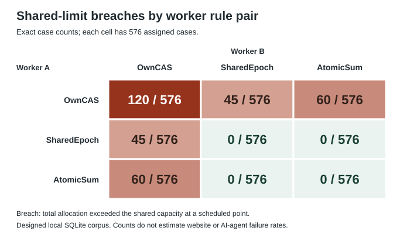

# One complete check does not protect a shared limit from another weak writer

Date: 2026-10-24, America/Toronto. Research note. Synthetic workload on a real local SQLite database.

## Abstract

Two workers can each change a different record correctly and still exceed a shared limit. We test whether one worker with a complete check protects a pair when the other worker checks only its own record. We run all nine ordered pairs of three rules over 576 selected scenarios each. Own-row checks exceed the limit in 120 of 576 cases. One atomic shared-sum check reduces this count to 60, but does not remove the failure. One shared-version check gives 45 such cases. All four pairs with two complete rules preserve the limit in 2,304 cases. Unrelated metadata changes cause extra feasible refusals with the shared-version rule. Two SQL runs and a separate specification give the same outcomes. These are exact counts for invented inputs and imposed schedules. They are not production agent error rates. The contribution is a repeatable comparison artifact for an established class of concurrency errors.

## Question and safety relevance

Does one worker with a complete shared-limit check protect the whole task when another worker checks only its own row?

A worker is a logical caller that can request a database change. A shared limit applies to the sum across workers. Examples include a total tool budget or a limit on concurrent tasks. A correct write to one row does not prove that the total remains permitted. This study examines that distinction at the admission step: the step that accepts an allocation. It does not test later spending or external actions.

## Related work and contribution

Berenson et al. describe write skew, where changes to different records violate a condition across those records. Their examples include a sum condition. This failure mechanism is established [1]. Joint analysis of different transaction rules is also established. Vandevoort et al. study mixed isolation assignments [2]. PostgreSQL guidance explains conditions that require consistent participation by transactions [3]. Our rules all use the same SQLite writer isolation. We do not test mixed database isolation levels.

Two recent preprints address AI agents. Zhu and Wang study budget conservation and explicitly require complete mediation: all relevant actions must pass the enforcing boundary [4]. CoAgent uses information about reads and writes to control concurrent agent work [5]. Our weak own-row rule is not an implementation of either system. We do not test or refute their full protocols. We checked selected sections, not all proofs or code. The exact reading scope is in [source_search.md](source_search.md).

SQLite permits one writer at a time. In WAL mode, a retained read snapshot cannot always upgrade to a write after another writer commits [6,7]. Our application reads finish before the later write transaction. The observed failures therefore do not show a SQLite isolation defect. PostgreSQL's transaction documentation supplies further background; PostgreSQL was not run [8].

Earlier repository work tested [repair dependencies](../2026-10-17-repair-dependencies/report.md), [undo visibility](../2026-10-22-undo-visibility/report.md), and [receipts versus current state](../2026-10-23-receipt-state/report.md). Those studies did not test this complete two-writer admission matrix. Broad revision checks and irrelevant-edit refusals are already present in the repair study.

The present contribution is a 5,184-case composition test, with complete SQL logs, per-effect checks, a paired metadata control, and a separately written specification. It supplies a small regression corpus: fixed examples that later implementations can repeat. A limited search does not establish priority. We claim no new concurrency protocol.

## Method

### Plan and contract

The hypotheses, inputs, measures, and stop limits were saved before implementation. A separate design review corrected one overly broad metadata check before any trial. Both plan versions and their hashes are retained. See [plan.md](plan.md), [freeze.json](freeze.json), and [changes.md](changes.md).

Workers A and B each request 1 or 2 units once. Capacity is 1, 2, 3, or 4 units. Both allocation rows start at zero, with version zero. A version is an integer that changes after a write. A separate quota row stores capacity, a shared version called an epoch, and a metadata bit. Metadata is descriptive data that does not affect capacity in this test.

The reference contract permits a write only when the resulting allocation sum is at most capacity. Every accepted allocation changes its own version and increments the epoch in the same transaction. A transaction is a group of database operations that commits as one unit. Allocations never decrease. There are no retries, crashes, expiry, or external effects.

### Three caller rules

Each worker has a read R and a later commit attempt C. R reads the complete state in one SELECT, fetches all rows, closes the cursor, and ends its transaction. Each rule refuses without a write if the read sum plus demand already exceeds capacity.

| Rule | Condition at the later write |
| --- | --- |
| OwnCAS | Own version equals the saved version, and own allocation is zero. CAS means compare and set. |
| SharedEpoch | OwnCAS conditions, plus the epoch equals the saved epoch. |
| AtomicSum | OwnCAS conditions, plus the current sum and demand do not exceed capacity. |

Every attempted write uses `BEGIN IMMEDIATE`. The guard, allocation, and epoch update share that transaction. A guard is a condition that must be true before a write. SharedEpoch and AtomicSum are called complete rules within this stated model. OwnCAS does not check all data needed for the shared condition.

An optional event U toggles the metadata bit and increments the epoch. It changes no allocation, capacity, or own-row version. There are six orders of RA, CA, RB, and CB with each R before its C. Each order has a no-U version and five U positions. Four demand pairs and four capacities give `6 × 6 × 4 × 4 = 576` scenarios per ordered rule pair. Nine pairs give 5,184 cases and 10,368 worker jobs.

Each full run uses one file database with distinct case IDs. All queries use that ID. Separate connections serve A, B, U, and the audit. WAL, synchronous FULL, and read-uncommitted OFF are set. The runner dispatches events sequentially in the prescribed order. This tests controlled overlaps between read and write steps. It is not an uncontrolled concurrent stress test.

### Measures and controls

A breach is a case with a sum above capacity at any observed step. A bad admission is an accepted effect that leaves this condition false. A feasible refusal rejects a job although the state just before C has enough capacity. Such a refusal is a cost under the numeric contract; it is not an error in the epoch rule itself.

We retain accepted and refused jobs, read denials, guard refusals, write attempts, excess units, and all row and epoch checks. There are two logical worker reads per case; audit reads and SQL guard reads are separate. The complete values and no-U/U strata are in [summary.csv](results/summary.csv).

Three engine controls test a stale same-row CAS, an attempted upgrade of a retained WAL snapshot, and rollback of allocation and epoch fields in one control row. The expected snapshot error is `SQLITE_BUSY_SNAPSHOT`, code 517. Additional checks cover fully serial OwnCAS schedules, worker exchange, epoch accounting, and every complete-rule pair.

The independent evaluator was written and frozen from the plan before it saw the main code or results. A later adapter compared the saved SQL evidence with that specification. Both code freezes and the review order are retained. Exact corpus counts need no sampling confidence intervals. The selected cases do not form a random sample of real workloads.

## Results

### Complete pair comparison

Each row below has 576 cases and 1,152 jobs. A and B designate the worker, not necessarily the first writer.

| Rule at A | Rule at B | Cases with a breach | Accepted jobs | Refused jobs | Feasible refusals |
| --- | --- | ---: | ---: | ---: | ---: |
| OwnCAS | OwnCAS | 120 | 948 | 204 | 0 |
| OwnCAS | SharedEpoch | 45 | 727 | 425 | 166 |
| OwnCAS | AtomicSum | 60 | 888 | 264 | 0 |
| SharedEpoch | OwnCAS | 45 | 727 | 425 | 166 |
| SharedEpoch | SharedEpoch | 0 | 532 | 620 | 336 |
| SharedEpoch | AtomicSum | 0 | 682 | 470 | 166 |
| AtomicSum | OwnCAS | 60 | 888 | 264 | 0 |
| AtomicSum | SharedEpoch | 0 | 682 | 470 | 166 |
| AtomicSum | AtomicSum | 0 | 828 | 324 | 0 |

All row-version and epoch-accounting checks passed. The largest excess was two units. Since allocations only increase, final excess equals maximum excess within each case. Bad admissions and breach cases have equal counts here: only the second accepted allocation can first exceed capacity. They are not independent failures.

For a minimal mixed example, capacity is one and both demands are one. A uses AtomicSum; B uses OwnCAS. Both read zero. A checks the current sum and commits one unit. B's own row is still unchanged, so B commits one unit. The total becomes two. See case `c00060` in [minimum_breaches.json](results/minimum_breaches.json). The complete check was correct at A's effect. It did not control B's later effect.

The counts also have a direct derivation. Five demand/capacity settings allow either job alone but not both. OwnCAS/OwnCAS fails in four base orders and six metadata variants: `5 × 4 × 6 = 120`. AtomicSum/OwnCAS fails in two such orders: `5 × 2 × 6 = 60`. SharedEpoch/OwnCAS has four preserving variants for one order and five for the other: `5 × (4 + 5) = 45`. The [independent review](independent_review.md) gives the orders and assumptions.

For two complete rules, each accepted effect preserves the bound. AtomicSum checks it directly within the write transaction. SharedEpoch has an eligible earlier read and no later epoch change. All accepted allocations change the epoch, so that saved allocation sum is still valid. Starting from zero, induction over accepted effects gives the bound after each effect. This argument requires all relevant writers to follow the stated rules and epoch protocol.

### Paired metadata comparison

For each rule pair, we match 480 U cases with their no-U counterparts. Each of the 96 no-U cases is reused five times. The paired counts are not independent samples.

Metadata changed no job decision in the four pairs without SharedEpoch. For SharedEpoch/SharedEpoch it reduced accepted jobs by 104 and added 144 feasible refusals over matched counterparts. For each SharedEpoch/AtomicSum orientation it reduced accepted jobs by 50 and added 70 feasible refusals. For each SharedEpoch/OwnCAS orientation it reduced accepted jobs by 65, added 70 feasible refusals, and removed 15 breaches. No matched pair gained a breach. Full results are in [paired_metadata.json](results/paired_metadata.json).

These changes are task-level effects. A metadata-induced refusal can change the capacity seen by the other worker. Thus a mixed pair cannot assume that the other worker's decisions remain unchanged. The reduction in breaches from an irrelevant edit is not a protection guarantee.

### Evidence checks and resources

Both complete SQL runs passed all controls. Seven deterministic output files matched byte for byte. The independent comparison matched all 5,184 cases, 10,368 decisions, 350,784 state values, 72,576 read values, 62,208 score values, and 137,132 SQL log statements. It also matched all 5,184 quota rows and 10,368 allocation rows in the reopened database. Integrity checks returned `ok`.

The tested environment was Python 3.13.7, SQLite 3.50.4, and macOS 26.7.2 on arm64. Main-run CPU times were 2.55 and 2.82 seconds. Wall times were 3.30 and 3.71 seconds. These are resource records, not comparative performance claims. Each run stayed below 120 CPU seconds, 450 wall seconds, and 500 MB of output. There was no unexpected failed main run. The expected code-517 control was a pass. No random seed, trained model, paid compute, or model API call was used in the experiment.

## Discussion and limitations

The measured result supports all four frozen hypotheses within this corpus. Correct local rows can coexist with an incorrect global total. One complete caller does not supply complete coverage. Two complete callers preserve the bound here. Broad shared versions can refuse numerically feasible work after irrelevant changes.

The practical implication is conditional: check every path that can consume the shared allowance. A service-level atomic limit could provide that boundary, but this study did not test such a deployment. Fresh browser reads alone do not supply an atomic guard on a remote effect.

The workload has two workers, small integer demands, one allocation per worker, and a fixed capacity. Larger groups, changing limits, cancellations, refunds, retries, crashes, and distributed effects are outside scope. The proof assumes no writer bypasses the guard or epoch update. An incorrect schema or untracked writer can invalidate it. One engine and version were tested. We make no portability, fairness, throughput, or eventual-completion claim.

No production website or connected account was changed. No computer-use model selected actions. The evidence is real local SQL execution of synthetic schedules, not measured AI behavior. The independent evaluator shares the written specification, so agreement can miss a shared specification error. Full enumeration removes sampling uncertainty only inside this finite model. It does not remove external-validity uncertainty. There are no training/test splits or learned parameters, so training leakage is not applicable.

## Ethics, rights, and review

All experiment records are invented. The package contains no account records, credentials, or personal test data. It includes source links and paraphrases, without source figures or copied implementation code. No new reuse license is assigned. The main misuse risk is to treat these bounded results as proof that a real agent or service is safe.

Codex generated the study, code, analysis, and report. Separate Codex agents reviewed sources, the design, the evidence, and the final report. They are AI reviewers. The exact host model build is not exposed in the saved run metadata; no model-performance comparison is made. No human review or external peer review occurred. There is no claimed university affiliation, endorsement, or certification.

Relevant parts of the NeurIPS Paper Checklist were used as a review aid [9]. This does not establish NeurIPS approval or submission compliance. See [review.md](review.md) and [README.md](README.md) for the checks, files, and reproduction commands.

## References

1. Berenson et al. (1995). [A Critique of ANSI SQL Isolation Levels](https://www.microsoft.com/en-us/research/wp-content/uploads/2016/02/tr-95-51.pdf). Write-skew sections checked.
2. Vandevoort et al. (2025). [Using Read Promotion and Mixed Isolation Levels for Performant Yet Serializable Execution of Transaction Programs](https://www.vldb.org/pvldb/vol18/p2846-vandevoort.pdf). PVLDB 18(9), 2846–2858. Abstract and introduction checked.
3. PostgreSQL 18. [Data Consistency Checks at the Application Level](https://www.postgresql.org/docs/18/applevel-consistency.html). Official documentation.
4. Zhu and Wang (2026). [Fault-Tolerant Budget Conservation in Distributed Multi-Agent Delegation](https://arxiv.org/html/2610.00349v1). Preprint v1; selected sections checked.
5. Lyu et al. (2026). [CoAgent: Concurrency Control for Multi-Agent Systems](https://arxiv.org/html/2606.15376v1). Preprint v1; selected sections checked.
6. SQLite. [Isolation In SQLite](https://www.sqlite.org/isolation.html). Official documentation.
7. SQLite. [Transaction](https://www.sqlite.org/lang_transaction.html). Official documentation.
8. PostgreSQL 18. [Transaction Isolation](https://www.postgresql.org/docs/18/transaction-iso.html). Official documentation.
9. NeurIPS. [Paper Checklist](https://neurips.cc/public/guides/PaperChecklist). Review aid.

All source access dates: 2026-10-24. Full entries are in [references.bib](references.bib). Reading limits and exact search terms are in [source_search.md](source_search.md).
