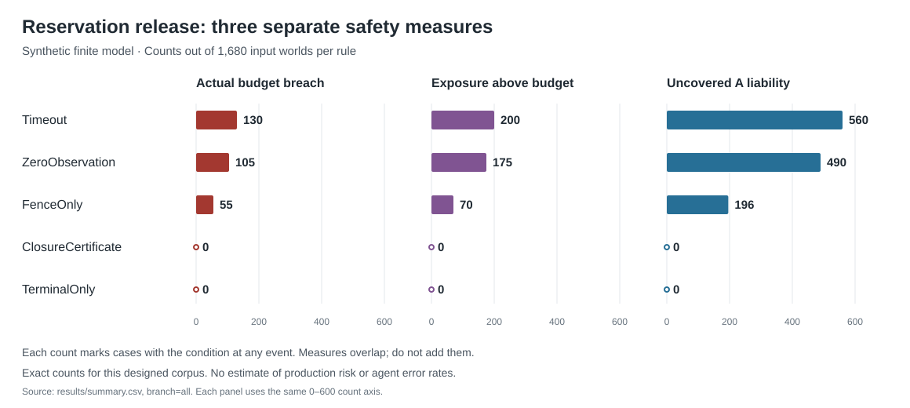

# Stopping new acceptance does not close an old reservation

Date: 2026-10-25, America/Toronto. Exact finite simulation. Research note.

## Abstract

A controller can stop new work while previously accepted work remains able to cause a charge. We compare five reservation-release rules on 1,680 designed event histories each. Releasing on a timeout causes actual budget breaches in 130 histories. A zero-charge observation gives 105 breaches. Release after an acceptance-fence receipt gives 55. This last rule also has 15 histories with temporary exposure above budget but no final actual breach. A sound closure certificate and a rule that waits for the final outcome have no breach or uncovered liability in the model. The certificate admits 110 more second jobs than waiting alone. Two runs and a separately written specification agree. The contribution is an exact comparison corpus for established conditions. It is not a new protocol, a production test, or an estimate of agent failure rates.

## Question and safety relevance

When does evidence that future acceptance is blocked justify release of a reservation for external work?

A reservation holds capacity for a job that can still use it. A fence blocks future acceptance of a specified job. A terminal outcome states that the job is finished and gives its final charge. These are different facts. A budget for an AI agent can cover paid calls, irreversible actions, or other cumulative use. Returning a reservation too early can let a second job use capacity that the first job still needs.

The budget here limits cumulative charges. It does not limit only the number of concurrent jobs. Completed use remains charged. No real money or external service was used.

## Related work and contribution

The closest work is Zhu and Wang's budget-conservation preprint. It already covers unsafe timeout refunds, retained uncertain holds, external exposure, and accepted work that completes after a fence [1]. Its no-effect certificate requires non-acceptance; accepted work has a separate terminal-settlement path. Our model's closure certificate also permits an accepted job with a known final zero charge. This is a stated model interface, not a reproduction of their certificate format or full system. We checked selected sections and did not reproduce their proofs or experiments.

The distinction between a timeout and an absent effect is established in AWS engineering guidance [2]. Google Cloud documents two relevant examples. Long-running-operation cancellation starts an asynchronous best-effort attempt; clients must check the outcome [3]. Cloud Run can close a timed-out connection while processing continues [4]. Neither service was tested. Chubby supplies established background on receiver checks for delayed requests [5]. These sources motivate the question; they do not supply our measurements.

The repository's [October 24 study](../2026-10-24-shared-limit/report.md) ends at local admission and excludes external effects and refunds. The [October 22 cancellation study](../2026-10-22-cancel-fencing/report.md) scores stale worker actions. This study instead separates acceptance, charge, receipt delivery, and reuse of reserved capacity. It checks both each intermediate state and the final state.

The new artifact contains all 60 permitted event orders, two outcome branches, 14 demand/capacity settings, five rules, and full independent comparison. The comparison separates unsafe release, uncovered liability, possible overspend, realized overspend, and refused feasible work. These mechanisms are known. A limited search cannot establish global novelty or priority. [source_search.md](source_search.md) preserves all search terms, checked sources, reading limits, and excluded leads. A candidate deadline question was not selected or tested.

## Method

### Plan, inputs, and common events

The [plan](plan.md) was saved and hashed before implementation at 11:08:28 UTC. The main implementation was frozen before its first run. A separate agent wrote and froze a specification without reading the main code or results. No plan or outcome rule changed after execution.

Initially job A has a reservation of `a` units and a request in transit. It is not yet accepted. B has no reservation. Demands `a` and `b` each range over 1 and 2. Total capacity `C` ranges over 1, 2, 3, and 4. We retain `a <= C`, which gives 14 settings. Each setting has a charge branch and a zero-charge branch for A's final outcome.

Each history contains six events:

| Event | Defined action |
| --- | --- |
| A | Accept the first job unless F already blocked acceptance. |
| E | Resolve the first job. An accepted job charges `a` in the charge branch and zero in the other branch. A rejected job charges zero in both. No later A charge remains possible after E. |
| T | Deliver the correct final result. Remove the hold and record the actual A charge exactly once. |
| O | Read the current A charge. This observation does not cancel work or block acceptance. |
| F | Block future A acceptance and record accepted, resolved, and charged status in one indivisible event. Previously accepted work can continue. |
| D | Apply the release rule, then check the local balance and admit and immediately charge B if it fits. |

An indivisible, or atomic, event has no intermediate state visible to another event. B is synchronous: its admission and charge occur together at D. This simplifies the second job; it is not a general provider guarantee.

Require `A < E < T` and `O < D`. The other event positions are free. There are `6! / (3! × 2!) = 60` orders. Thus `14 × 2 × 60 = 1,680` input worlds and 8,400 rule outcomes. A world is one complete input setting and event order. Charge/zero copies after a rejected acceptance remain as deliberate controls. They are not independent observations.

Every rule receives the same O, F, and T events. We compare how the rules use evidence. We do not compare the cost or availability of deploying a fence. The name Timeout denotes release at D without final evidence. The model has no elapsed-time or execution-deadline test.

### Release rules

All rules first honor a delivered T result. If T precedes D, no hold remains. Otherwise:

| Rule | Condition for early release at D |
| --- | --- |
| Timeout | Release the hold. |
| ZeroObservation | O reported zero charge. |
| FenceOnly | F occurred. |
| ClosureCertificate | The saved F receipt proves that A was not accepted, or was already resolved with zero charge. |
| TerminalOnly | Do not release early; wait for T. |

The closure proof includes the fence at F. When A was not accepted, no later acceptance can occur. When A already resolved with zero charge, its final outcome cannot change. The certificate is assumed correct and bound to this exact job. This is stronger evidence than a fence acknowledgement alone.

Local available balance is `C - hold_A - booked_A - booked_B`. Each B admission uses that balance atomically. A late T still records a real charge after a premature release. The available balance can then become negative. The program does not hide the charge or create a negative hold.

### Truth and measures

Provider liability `L` is the largest total A charge still compatible with the provider's current state and its declared maximum charge. It is `a` when A has charged, is accepted but unresolved, or can still be accepted. It is zero after a final zero result, or when A was never accepted and future acceptance is blocked. The future branch is not used to reduce unresolved liability. The audit therefore does not use hindsight to make pending work appear safe.

After every event, we measure:

- Actual excess: `max(0, actual_A + booked_B - C)`.
- Exposure excess: `max(0, L + booked_B - C)`.
- Uncovered A liability: `max(0, L - hold_A - booked_A)`.
- Local deficit: `max(0, -available)`.

A breach case has a positive value at some step. A prefix is the history through that step. A premature refund removes a positive hold while `L > 0`. A safe-feasible refusal rejects B although the authoritative pre-D state satisfies `L + b <= C`. Such a refusal measures conservative lost opportunity, not a safety failure. The rule itself does not receive this audit truth.

We retain every observation, receipt, decision, state, first bad step, maximum excess, and final outcome. Measures overlap and must not be added into one failure total. Exact counts for the full finite corpus do not need sampling intervals or significance tests.

## Results

### Safety and admission

Each row has 1,680 worlds. All outcomes completed under the specification.

| Rule | Actual breach | Exposure breach | Uncovered A liability | Exposure but no final actual breach | B accepted | Safe-feasible refusal |
| --- | ---: | ---: | ---: | ---: | ---: | ---: |
| Timeout | 130 | 200 | 560 | 70 | 1,465 | 0 |
| ZeroObservation | 105 | 175 | 490 | 70 | 1,440 | 0 |
| FenceOnly | 55 | 70 | 196 | 15 | 1,305 | 30 |
| ClosureCertificate | 0 | 0 | 0 | 0 | 1,215 | 50 |
| TerminalOnly | 0 | 0 | 0 | 0 | 1,105 | 160 |

The largest excess or uncovered amount is two units. Every premature-refund case also has uncovered liability here, with equal counts. Every actual-breach case eventually has a negative local balance when the correct receipt arrives. These equalities follow from this model and are not separate failure totals. [summary.csv](results/summary.csv) includes branch-specific results and all reported measures.

The closure rule admits 110 more B jobs than TerminalOnly in matched worlds. It never rejects a B job that TerminalOnly accepts. Safe-feasible refusals decrease from 160 to 50. The stronger interface thus improves admission in this corpus while preserving the bound. It does not guarantee progress in a wider system.

### Why a fence receipt is insufficient

Let `a=b=C=1` and use `A,O,F,D,E,T` in the charge branch. A is accepted. O correctly observes zero current charge. F correctly blocks future acceptance, but A is already accepted. Timeout, ZeroObservation, and FenceOnly release the hold and admit B. At D, liability plus B is two, above the capacity of one. E later charges A, so actual use is two. T correctly records the late charge and reveals a local deficit.

ClosureCertificate and TerminalOnly keep the hold and refuse B in this history. No observation or fence acknowledgement in the weak-rule trace is false. The release inference is the error.

In the zero branch of the same order, exposure at D is still two. The provider has not yet resolved A, so a full charge remains possible under the declared contract. E later resolves with zero. Final actual use is one. A check of only the final charge misses the earlier exposure. This difference explains why realized overspend is a weaker measure than coverage at every step.

### Why the closure rule still refuses feasible work

For `A,F,E,O,D,T` in the zero branch, F occurs while A is accepted and unresolved. Its saved certificate is false. E later resolves A with zero charge, and O observes zero. ClosureCertificate still refuses B at D when capacity is one because it uses only the saved F certificate or T. It does not combine a fresh terminal query with the fence. TerminalOnly also refuses. This is a conservative limitation of the selected rules, not proof that the provider cannot supply better evidence.

By contrast, `A,E,F,O,D,T` in the zero branch gives a valid certificate at F and permits the closure rule to release. Named controls preserve both orders. [witnesses.json](results/witnesses.json) preserves first examples in the declared enumeration order, without a global minimality claim.

### Checks and resources

All 35 named control rows passed. Complete-rule checks covered 3,360 outcomes. There were 672 T-before-D worlds with equal decisions across all rules, 4,800 ample-budget outcomes, and 4,200 charge/zero pairs with equal state prefixes before E. The common fence blocked acceptance in 420 worlds per rule.

Two full runs produced seven identical deterministic files. The independent position-based specification matched all 8,400 outcomes, 50,400 events, 2,220,400 event-state scalar values, 386,400 initial/final state values, 176,400 score values, 15 summary rows, and 10 matched-rule comparisons. It also checked the named controls and saved witnesses. See [independent_review.md](independent_review.md).

The environment was Python 3.13.7 on macOS 26.7.2, arm64. Main-run CPU times were 2.40 and 2.37 seconds; wall times were 2.44 and 2.39 seconds. Each primary result set used about 1.39 MB before environment metadata. Per-run limits were 120 CPU seconds, 300 wall seconds, and 200 MB. No main run failed. There was no paid compute, network call, or model invocation inside the simulator. There is no random seed.

## Conditional safety argument

TerminalOnly retains enough hold to cover A until T replaces it with the correct booked charge or a final zero outcome. ClosureCertificate releases earlier only when A cannot charge. Thus each rule maintains `L <= hold_A + booked_A`.

Before B is admitted, the atomic local check requires `hold_A + booked_A + b <= C`. Combining the conditions gives `L + b <= C`. Later events cannot increase A beyond the current liability bound. B does not change again. The bound therefore holds after every event. This argument requires correct charge bounds, complete control of acceptance, sound job-specific evidence, and correct settlement. It does not make a client-only cancellation request sufficient.

## Discussion, limitations, and uncertainty

All four planned hypotheses hold in the selected corpus. A successful stop of new acceptance does not settle previously accepted work. A final charge-only audit can also hide a period of excess exposure. The useful check is whether the old obligation is closed or remains covered when capacity is reused.

This is a simulation of two jobs and one budget dimension. A charges either zero or its full reservation. B charges immediately. Every terminal result eventually arrives. There are no retries, duplicate receipts, crashes, partial charges, changing prices, competing authorities, compromised certificates, or identity mistakes. Certificates and fences are assumed available; no real endpoint was tested for these features.

The schedules are designed, not sampled from real agent use. Duplicate branches after blocked acceptance remain in the denominator. Results do not estimate operational risk, delay, throughput, or an agent's choice of rule. The independent implementation reduces coding error but shares the written model. It can miss a shared specification mistake. Full enumeration removes sampling uncertainty only within the chosen finite scope. No learning or data split occurs, so training leakage is not applicable.

## Ethics, rights, and review

All inputs are invented numbers and event names. No connected account, payment, or production record was changed. The package contains no credentials or private account data. Sources are linked and paraphrased. No source paper, figure, or implementation is redistributed. No new reuse license is assigned.

Codex generated the study, code, analysis, and report. Separate Codex agents reviewed the sources and method, and wrote the independent specification. The exact host model build is not exposed in the run metadata. The simulator does not use a language model. No human review or external peer review occurred. No affiliation, endorsement, or certification is claimed.

The main misuse risk is to treat a simplified model result as a deployment guarantee. The report therefore distinguishes a local decision, a provider acceptance fence, and final evidence. Relevant parts of the NeurIPS Paper Checklist were used as a review aid [6], with no claim of NeurIPS approval or submission compliance. [review.md](review.md) records the final checks.

## Reproduction and references

Use [README.md](README.md) for exact commands. The package includes the frozen plan and implementation, all inputs and traces, controls, summaries, first witnesses, paired comparisons, environment records, two run logs, and the independent checker.

1. Zhu and Wang (2026). [Fault-Tolerant Budget Conservation in Distributed Multi-Agent Delegation](https://arxiv.org/html/2610.00349v1). Preprint v1. Selected sections checked; not reproduced.
2. Brooker (2019). [Timeouts, retries, and backoff with jitter](https://aws.amazon.com/builders-library/timeouts-retries-and-backoff-with-jitter/). AWS Builders' Library.
3. Google Cloud. [Package google.longrunning](https://docs.cloud.google.com/translate/docs/reference/rpc/google.longrunning). Official Operations reference.
4. Google Cloud. [Configure request timeout for services](https://docs.cloud.google.com/run/docs/configuring/request-timeout). Official documentation.
5. Burrows (2006). [The Chubby lock service for loosely-coupled distributed systems](https://www.usenix.org/legacy/event/osdi06/tech/full_papers/burrows/burrows.pdf). OSDI. Abstract and Section 2.4 checked.
6. NeurIPS. [Paper Checklist](https://neurips.cc/public/guides/PaperChecklist). Review aid.

Sources accessed on 2026-10-25. Exact reading scope is in [source_search.md](source_search.md); citation records are in [references.bib](references.bib).
